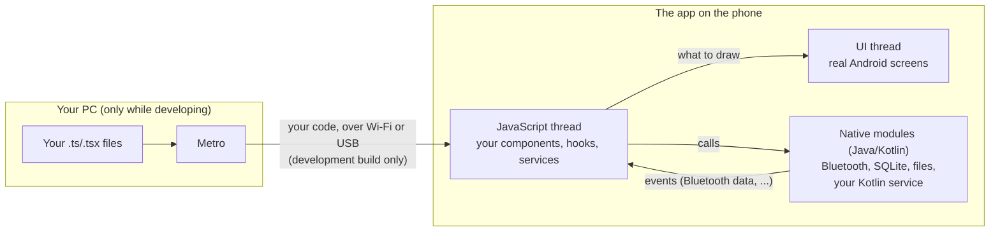

# How Expo and React Native work

> For someone who's built an app with Expo Go but never had to look underneath. This
> project needs you to, in two places: native libraries (Bluetooth) and the screen
> turning off mid-workout. Everything else will feel familiar.
>
> React and TypeScript patterns are in
> [`00a-React-And-TypeScript-Essentials.md`](00a-React-And-TypeScript-Essentials.md).

## In one sentence

You write TypeScript; React Native runs it on the phone, turns your components into real
Android screens, and lets your code call Android features (Bluetooth, the database,
files) through **native modules**; Expo builds the app and handles the Android setup for
you.

## The parts



- **Metro** bundles your code and sends it to the phone. When you save, it sends the
  change and the app updates (Fast Refresh). In a release build, the code is inside the
  app and Metro isn't involved.
- **The JavaScript thread** runs *all* your code. There's only one. So you never manage
  threads in this project. It also means a slow loop in your code freezes everything
  else your code does.
- **Hermes** is the JavaScript engine on the phone. You'll only see its name in
  profilers.
- **The UI thread** draws real Android views. A `<View>` becomes an Android view; a
  `<Text>` becomes a text view. That's why React Native apps feel native.
- **Native modules** are Java or Kotlin code your TypeScript can call. The Bluetooth
  library, `expo-sqlite` and `expo-file-system` are native modules. So is the Kotlin
  background service you'll write in Phase 07.

**What this means for Bluetooth:** a packet arrives in Android's Bluetooth code (inside
the library), gets turned into an event, and your listener runs on the JavaScript thread
with an array of bytes. Everything after that (hex, decoding, the workout, saving) is
your TypeScript.

## Expo Go vs. development build vs. release build

| | Expo Go | Development build | Release build |
|---|---|---|---|
| What it is | Expo's app from the Play Store | Your own app, with a developer menu | Your own app, optimised |
| Native libraries | Only the ones Expo Go includes | **Whatever your project uses** | Whatever your project uses |
| Where your code comes from | Metro on your PC | Metro on your PC | Inside the app |
| Updates when you save | Yes | Yes | No |
| How to get it | Install from the store | `npx expo run:android --device` | `npx expo run:android --variant release` |
| Use it for | Apps that only need what Expo Go has | **Everyday work on this project** | Speed and battery tests, screen-off tests, daily use |

Your exam app ran in Expo Go because Expo Go had everything it needed. This app needs a
Bluetooth library Expo Go doesn't have, so Expo Go can't run it. A development build is
the fix: "your own Expo Go, with your libraries inside". Build it once, and after that
it's the same as before: `npx expo start`, edit, save, watch it update.

**When do you rebuild?** Only when something *native* changes: adding a library with
Android code, changing `app.json` (permissions, plugins, icons), or editing Kotlin.
Changing TypeScript never needs a rebuild. Not sure if a library is native? If its
instructions say "rebuild your app", or it adds itself to `app.json`'s plugins, it is.

## Why there's no `android/` folder to edit

Underneath, every React Native app is a normal Android project. In plain React Native,
you edit that project by hand, forever, and every upgrade means merging changes into
your edits.

Expo turns it around. The `android/` folder is **generated** from `app.json` every time
you build, it's ignored by git, and you never edit it. Android settings go in one of
three places instead:

1. **`app.json`**: the common settings (package name, permissions, Android version,
   icons, splash).
2. **Config plugins**: small JavaScript files that adjust the generated Android files.
   Many libraries include one (the Bluetooth library's adds its permissions). Phase 11
   adds one of ours, about ten lines.
3. **Local Expo modules** (`src/modules/<name>/`): real Kotlin code that's part of the
   project and *is* committed. Its own settings are merged into the app when it builds.
   Phase 07's background service lives here.

The benefit: delete `src/android/` any time, and the next build recreates it exactly.

## Where code goes

```
src/app/        screens: one file per screen, nothing else in them
src/features/   React code: screens' parts, hooks, and code that uses phone features
src/core/       plain TypeScript: decoding, the workout engine, the database code, backup
src/modules/    Kotlin
```

**The `core/` test:** a file goes in `src/core/` if it imports nothing from `react`,
`react-native` or `expo-*`. A lint rule checks this, and Jest tests `core/` on the PC.
That's what lets the decoder, the workout engine and the database code have quick tests
without a phone. When something in `core/` needs a phone feature (a unique ID, the time,
a file, a vibration), it's passed in from outside, and `features/` provides the real
one. You'll see this in Phases 06, 08, 09 and 13.

**Screen files are tiny.** `src/app/settings.tsx` is three lines: import `SettingsScreen`
from `features/` and export it. The file's location decides the route; the screen itself
lives with its hook.

## The services file: why the important objects live outside components

`src/features/services.tsx` creates every long-lived object once: the Bluetooth client,
the treadmill service, the workout engine, the recorder, the database, the settings.
Screens get them with `useServices()`.

Why not create them in a component with `useState`? Because a component lives only as
long as its screen, and these objects must outlive every screen:

- Go from the dashboard to History mid-workout: the dashboard closes. The workout must
  keep recording.
- Drag the split-screen divider: Android may rebuild the screen. The Bluetooth
  connection mustn't notice.
- Lock the phone: no screen is showing at all. Everything must keep running.

Objects in the services file live as long as the app itself. The rule that keeps it
working: **anything that must survive a screen change lives in the services file, never
in a component's state.** Components read from services and call them; they never own
them.

## Hooks do the "ViewModel" job

| Role | In this project | Who writes it |
|---|---|---|
| The data and logic | `src/core/`: the treadmill service, engine, database code | you |
| The screen's brain | one hook per screen: `useDashboard()`, `useSpeedControl()`, `useSettings()` | you |
| The screen | the component that calls the hook and shows what it returns | the agent |

The hook listens to services (`useEffect` or `useSyncExternalStore`), keeps the screen's
state, and offers functions the screen calls. The screen never touches a service itself.
That's the line between your code and the agent's.

## The hard part: when the screen turns off

This is the one area where React Native is harder than plain Android, and why Phase 00
has a keep-alive test. Three different things can stop, for three different reasons:

| What stops | Why | What keeps it going |
|---|---|---|
| **The whole app** gets closed | Android (and HyperOS, more aggressively) closes background apps to save memory and battery | A **foreground service** with a notification, plus HyperOS's Autostart / Battery saver / Recents-lock settings |
| **Timers** stop (`setTimeout`, `setInterval`) | React Native pauses them when the app isn't on screen, unless a headless JS task is running | A **headless JS task** that never finishes until the workout ends, started by the service |
| **The CPU** sleeps between events | Android's deep sleep (Doze), on a phone lying still on the treadmill | A **wake lock**, held by the service while the task runs, plus turning off battery optimisation |

Bluetooth packets keep arriving as long as the app is alive. But a lot of this app runs
on timers (the 3-second command timeout, reconnect delays, the 60-second grace period,
the save timer). So "packets arrive but timers don't" is a real, silent failure. Part H
of the Phase 00 runbook measures exactly that: the biggest gap between packets, and the
biggest gap between timer ticks.

Two practical rules:

- **Test screen-off behaviour unplugged, on the release build.** The phone doesn't go
  into deep sleep while charging, and the development build needs Metro.
- **Start the keep-alive only from a tap** (the Start button). Android blocks starting
  these services from the background anyway, and this project never starts a workout by
  itself.

## Day to day

```powershell
cd src
npx expo start          # Metro; the app on the phone connects to it
```

- Save a file: the app updates.
- Press `r`: reload everything (services are created again).
- Press `j`: React Native DevTools (console, breakpoints, component tree, memory).
- Logs: `console.log` shows in the terminal and in `adb logcat -s ReactNativeJS`. The
  Bluetooth library's own logs: `adb logcat -s RNBleManager`.
- Changed something native? Stop Metro, run `npx expo run:android --device`, start again.

## Next

- [`00a-React-And-TypeScript-Essentials.md`](00a-React-And-TypeScript-Essentials.md)
- [`01-Device-And-Emulator-Setup.md`](01-Device-And-Emulator-Setup.md): getting the app
  onto your phone
- [`02-Glossary.md`](02-Glossary.md): every term, one line each
- [Phase 00's technology decisions](../../phases/phase-00-probe-app/README.md#technology-decisions):
  why Expo, and why each library
