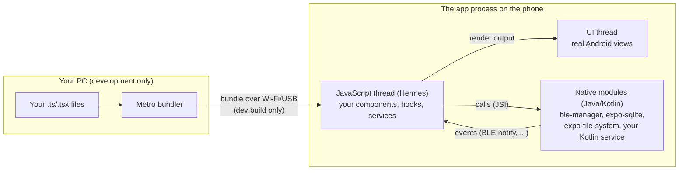

# How Expo and React Native fit together

> For someone who has built an app with Expo Go but never had to think about what
> happens underneath it. This project needs you to, in two places: native modules
> (Bluetooth) and background work (the screen turning off mid-workout). Everything
> else will feel familiar.
>
> React and TypeScript patterns themselves are in
> [`00a-React-And-TypeScript-Essentials.md`](00a-React-And-TypeScript-Essentials.md).

## The one-sentence version

You write TypeScript that describes the screens and the logic; React Native runs that
TypeScript on its own JavaScript thread inside a real Android app, turns your
components into real Android views, and lets your code call native Android code
(Bluetooth, SQLite, files) through **native modules**; Expo is the toolkit around it
that builds the Android app, supplies most of the native modules, and keeps the
native project out of your way.

## The moving parts



- **Metro** bundles your TypeScript into one JavaScript file. In development it serves
  that bundle to the phone over the network and pushes changes instantly (Fast
  Refresh). In a release build, the bundle is baked into the APK and Metro isn't
  involved at all.
- **The JavaScript thread** runs all of your code: every component, every hook, every
  service, every BLE event handler. There is one of it. That's why this project never
  talks about thread marshalling: there's nothing to marshal between. It's also why a
  slow loop in your code freezes everything else your code does.
- **Hermes** is the JavaScript engine React Native uses. You won't touch it directly;
  you'll see it in profiler output.
- **The UI thread** draws the actual Android views your components describe. A
  `<View>` becomes an Android `ViewGroup`; a `<Text>` becomes a `TextView`. This is why
  React Native apps feel native: they are.
- **Native modules** are Java/Kotlin code exposed to JavaScript. Under the **New
  Architecture** (always on from Expo SDK 55), calls go through **JSI**, a direct
  interface between the JavaScript engine and native code, instead of the old
  message-passing "bridge." `react-native-ble-manager`, `expo-sqlite` and
  `expo-file-system` are native modules; so is the Kotlin foreground service this
  project writes in Phase 07.

**The practical consequence:** BLE notifications arrive in native code (Android's
`BluetoothGatt` callbacks inside ble-manager), are converted to a JavaScript event, and
your `onDidUpdateValueForCharacteristic` listener runs on the JavaScript thread with a
`number[]` of bytes. Everything from there (hex, parsing, the workout engine, SQLite
writes) is your TypeScript.

## Expo Go, development builds, release builds

| | Expo Go | Development build | Release build |
|---|---|---|---|
| What it is | Expo's prebuilt app from the Play Store | Your own app, compiled once, with a dev menu | Your own app, optimised, no dev tooling |
| Native modules | Only the fixed set Expo Go ships | **Whatever your project includes** | Whatever your project includes |
| Where the JavaScript comes from | Metro on your PC | Metro on your PC | Inside the APK |
| Fast Refresh | Yes | Yes | No |
| Build it with | (nothing, install from the store) | `npx expo run:android --device` | `npx expo run:android --variant release` |
| Use it for | Apps with only Expo-Go-compatible modules | **Day-to-day development of this project** | Performance numbers, the screen-off tests, daily use |

Your exam app ran in Expo Go because everything it needed was already inside Expo Go.
This project needs `react-native-ble-manager`, which isn't, so Expo Go can't run it at
all. A development build is the fix: think of it as "your own Expo Go, with your
native modules inside." You build it once, and after that the loop feels identical:
`npx expo start`, edit, save, watch it update on the phone.

**When do you rebuild?** Only when *native* things change: adding or upgrading a
package that contains native code, changing `app.json` (permissions, plugins, SDK
levels, icons), or editing Kotlin in `src/modules/`. Editing TypeScript never needs a
rebuild. If you're unsure whether a package is native, the rule of thumb is: if
`npx expo install` puts it in `app.json`'s plugins or its README says "rebuild your
app," it's native.

## Continuous Native Generation: why there's no `android/` folder to edit

Every React Native app is, underneath, a normal Android project (Gradle, Kotlin,
`AndroidManifest.xml`). In a "bare" React Native app you edit that project by hand,
forever, and every React Native upgrade means merging Facebook's template changes
into your edits.

Expo flips that around. The `android/` folder is **generated** from `app.json` by
`npx expo prebuild` (which `npx expo run:android` runs for you), it's in `.gitignore`,
and you never edit it. Any native setting lives in one of three places instead:

1. **`app.json`**: the common things (package name, permissions, SDK levels via the
   `expo-build-properties` plugin, icons, splash).
2. **Config plugins**: small JavaScript functions that edit the generated native files
   during prebuild. Many libraries ship one (ble-manager's adds the Bluetooth
   permissions). You write your own for anything else; Phase 11's
   `withResizeableActivity.js` is fifteen lines.
3. **Local Expo modules** (`src/modules/<name>/`): real Kotlin source code that belongs
   to the project and *is* committed. Its own `AndroidManifest.xml` is merged into the
   app's at build time. Phase 00/07's foreground service lives here.

The payoff: delete `src/android/` at any time and `npx expo prebuild --clean` recreates
it identically. The native project can't quietly drift into a state nobody remembers
creating.

## Where code lives in this project, and why

```
src/app/        routes: one file per screen, and nothing else in them
src/features/   the React side: screen components, hooks, adapters to native modules
src/core/       plain TypeScript: protocol, engine, repositories, backup
src/modules/    Kotlin
```

**The `core/` test.** A file belongs in `src/core/` if it imports nothing from
`react`, `react-native` or any `expo-*`/native package. A lint rule enforces this, and
Jest runs everything in `core/` in plain Node. That's what lets the FTMS parser, the
workout engine and the SQL repositories have real, fast tests with no phone in the
loop. When something in `core/` needs a native capability (a UUID, a clock, a file, a
haptic), the capability is passed in from outside (a function or a small interface),
and `features/` supplies the real one. You'll see this "inject what `core/` can't
import" move in Phases 06, 08, 09 and 13.

**Route files are thin.** `src/app/settings.tsx` is three lines: it imports
`SettingsScreen` from `features/` and exports it. Expo Router decides *which* screen
from the file path; the screen itself lives with its hook.

## The composition root: why services live outside components

`src/features/services.tsx` creates every long-lived object once, at module scope:
the BLE client, the treadmill service, the workout engine, the recorder, the
database, the settings. Screens get them with `useServices()`.

Why not create them inside components, with `useState` or `useRef`? Because a
component's lifetime is a screen's lifetime, and this app's most important objects
must outlive every screen:

- Navigate from the dashboard to History mid-workout: the dashboard unmounts. The
  workout must keep recording.
- Drag the split-screen divider: Android may recreate the activity, React remounts the
  tree. The Bluetooth connection must not notice.
- Lock the screen: no screen is visible at all. Everything must keep running.

Module-scope objects live as long as the JavaScript runtime, which lives as long as
the app's *process*. That's exactly the lifetime the connection and the workout need.
The rule that keeps it working: **nothing that must survive a screen change lives in
component state.** Components read from services and call them; they never own them.

## Hooks as the "ViewModel"

If you've read about MVVM: this project has the same three roles, without the
framework.

| Role | In this project | Who writes it |
|---|---|---|
| Model | `src/core/`: the treadmill service, engine, repositories | you |
| ViewModel | a hook per screen: `useDashboard()`, `useSpeedControl()`, `useSettings()` | you |
| View | the screen component that calls the hook and renders what it returns | the agent |

The hook subscribes to services (in `useEffect`, or with `useSyncExternalStore`),
holds the screen's derived state, and exposes functions the screen calls. The screen
component never touches a service directly. That's the line between your code and the
agent's in `phases/README.md`.

## The hard part: what happens when the screen turns off

This is the one area where React Native is genuinely harder than native Android, and
it's why Phase 00 has a "keep-alive spike." Three separate things can stop, for three
separate reasons:

| What stops | Why | What keeps it going |
|---|---|---|
| **The process** gets killed | Android (and HyperOS, more aggressively) reclaims background apps for memory and battery | A **foreground service** with a visible notification, plus HyperOS's Autostart / Battery saver / Recents-lock settings |
| **JavaScript timers** stop firing (`setTimeout`, `setInterval`) | React Native pauses its timer module when the activity is paused, unless a headless JS task is running | A **headless JS task** that never finishes until the workout ends, started by the foreground service |
| **The CPU** dozes between events | Android's Doze mode and idle CPU sleep, on a phone that's sitting still on a treadmill console | A **partial wake lock** (held by `HeadlessJsTaskService` while the task runs) and the battery-optimisation exemption |

BLE notifications themselves keep arriving as long as the process is alive: the
Bluetooth stack wakes the CPU to deliver them. But a lot of this app's logic is
timer-driven (the control-point timeout, reconnect backoff, the 60-second grace
period, the flush interval), so "events arrive but timers don't" is a real, silent
failure mode. That's precisely what the Phase 00 runbook's Part H measures, with two
numbers: the biggest gap between BLE notifications, and the biggest gap between
heartbeat timer ticks.

Two practical rules fall out of this:

- **Test screen-off behaviour unplugged, on the release build.** Doze doesn't happen
  while charging, and the development build depends on Metro.
- **Start the keep-alive only from a deliberate tap** (the Start button), never in
  the background. Android restricts starting foreground services from the background
  anyway, and the safety rules in this project forbid anything starting a workout on
  its own.

## The everyday loop

```powershell
cd src
npx expo start          # Metro; the dev build on the phone connects to it
```

- Save a `.ts`/`.tsx` file: Fast Refresh updates the running app, keeping state where
  it can.
- Press `r` in the terminal: full reload of the JavaScript (services are recreated).
- Press `j`: React Native DevTools (console, breakpoints, React component tree,
  memory snapshots).
- Logs: `console.log` shows in the terminal and in `adb logcat -s ReactNativeJS`.
  ble-manager's native logs are `adb logcat -s RNBleManager`. Kotlin `Log.d(...)` calls
  show under whatever tag you give them.
- Changed something native? Stop Metro, `npx expo run:android --device`, start again.

## Where to go next

- [`00a-React-And-TypeScript-Essentials.md`](00a-React-And-TypeScript-Essentials.md):
  the React and TypeScript patterns this codebase leans on, explained properly.
- [`01-Device-And-Emulator-Setup.md`](01-Device-And-Emulator-Setup.md): getting a
  development build onto the Poco X6 Pro.
- [`02-Glossary.md`](02-Glossary.md): every term above, in one line each.
- [`../../phases/phase-00-probe-app/README.md`](../../phases/phase-00-probe-app/README.md#technology-decisions):
  why Expo, and why each library, in full.
