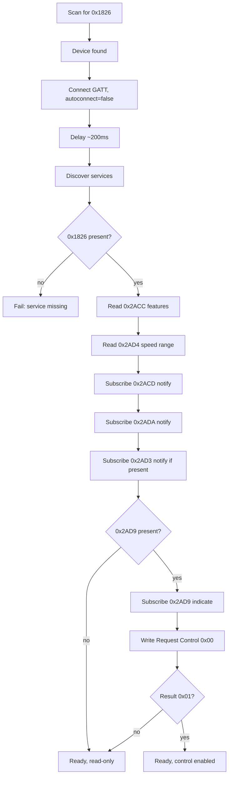

# Phase 00 — Probe App

> **This phase exists to make the treadmill answer questions, not to build a product.**
> Every screen here is a lab instrument. None of it ships in the final UI, and none of
> it needs to be pretty. It needs to be *correct about bytes*.

**Hardware:** required, at the end · **Size:** L · **Blocks:** everything

---

## Goal

Produce an installable Android app that, on the operator's phone, can:

1. Find the treadmill and connect to it.
2. Show every service and characteristic, and dump every readable one as raw hex.
3. Subscribe to every notifying characteristic and log each packet as
   `timestamp | uuid | hex`.
4. **Send arbitrary bytes to the control point `0x2AD9` and show the raw response**,
   both via preset command buttons and via a free-text hex field.
5. **Record what happened**: export the session as a file, and let the operator mark
   an observation as confirmed-correct with a note.
6. **Keep recording with the screen off**, via a minimal foreground service and
   keep-alive task, so the one risk the Expo stack adds (JavaScript pausing in the
   background) is tested on the real treadmill before any product code depends on
   it.

After this phase, the question "what data should we send to the treadmill?" is
answered by experiment rather than by reading a spec and hoping the vendor followed it.

## Why it is shaped this way

The device is a **FitShow BLE module** presenting an FTMS shim over a transparent
UART bridge (`PHASE-00-FINDINGS.md`). Its own feature declaration `0x2ACC` is **provably
false**: it claims incline target setting on a machine with no incline. A shim that
lies about itself is not a thing to build three phases of product on top of.

So the first deliverable is the instrument, and the instrument's output becomes the
specification.

Goal 6 is here for the same reason, applied to the platform instead of the device.
React Native runs your TypeScript on one JavaScript thread, and Android pauses that
thread's timers when the app goes to the background unless something tells it not
to. Whether a foreground service plus a headless JS task keeps it running on
HyperOS, for an hour, with YouTube open in the other half of the screen, is a
question with a yes/no answer. Phase 00 gets that answer on day one instead of
discovering it in Phase 14 after thirteen phases were built on top of it.

---

## Reference docs

Read these. Do not read other phase folders.

- The protocol reference below: characteristics, control point commands and
  response format, connection sequence. **The control point section is the one
  this phase is built around.** (Parsing the data-stream characteristics, the
  actual byte decode, is out of scope here; that's Phase 01, deliberately, per
  the Scope section below.)
- `HUMAN-RUNBOOK.md`: the manual procedure this phase's Probe Checklist screen (0.9)
  automates.
- `PHASE-00-FINDINGS.md`: what is already measured. Everything marked NEEDED is your target.
- `../../README.md`: stack table, build commands.
- `../../docs/learning/00-Expo-And-React-Native.md`: the "JS thread vs. native" and
  "background" sections explain why task 0.12 exists.

---

## Protocol reference: characteristics and control point

> This is the minimal slice of the FTMS protocol this phase needs standalone, so
> this folder stays self-contained per `../README.md`'s own rule. The full
> byte-level parsing reference (feature flags, treadmill data fields and their
> traps, heart rate, machine status, training status) lives in
> `../phase-01-protocol-decode/README.md`, since that's the phase that actually
> decodes them. This phase only dumps hex and sends control commands; it doesn't
> decode the data stream.

### FTMS characteristics

| UUID | Name | Properties |
|------|------|------------|
| `0x2ACC` | Fitness Machine Feature | Read |
| `0x2ACD` | Treadmill Data | Notify |
| `0x2AD3` | Training Status | Read, Notify |
| `0x2AD4` | Supported Speed Range | Read |
| `0x2AD9` | Fitness Machine Control Point | Write, Indicate |
| `0x2ADA` | Machine Status | Notify |

Plus `1800` Generic Access, `180A` Device Information, `180D` Heart Rate, and the
vendor `FFE0`/`FFF0` transparent-serial services (FitShow, recorded only; see
`PHASE-00-FINDINGS.md`).

### Control point (`0x2AD9`) commands

The only writable characteristic. **Mandatory sequence**: omitting any step is
the usual cause of silent failure.

1. **Enable indications** on `0x2AD9` (write `0x0002` to CCCD `0x2902`).
2. **Write `Request Control` (`00`)** and wait for a successful indication.
3. Only then send any other command. Use **Write With Response**.
4. **Serialise commands**: one outstanding, wait for the indication (3 s timeout)
   before the next.

| Command | Bytes | Notes |
|---------|-------|-------|
| Request Control | `00` | Must succeed first |
| Reset | `01` | |
| Set Target Speed | `02 LL HH` | uint16 LE, 0.01 km/h |
| Set Target Inclination | `03 LL HH` | sint16, 0.1 %: not applicable, no incline |
| Start or Resume | `07` | |
| Stop or Pause | `08 01` (stop) / `08 02` (pause) | **Parameter byte is mandatory** |

Set Target Speed example: 6.5 km/h → 650 → `0x028A` → bytes `02 8A 02`.

**Response** arrives as an indication: `[0] 0x80 (always) [1] echoed op code [2]
result code [3..] rare parameters`.

| Result | Meaning |
|--------|---------|
| `0x01` | Success |
| `0x02` | Op Code not supported |
| `0x03` | Invalid Parameter |
| `0x04` | Operation Failed |
| `0x05` | Control Not Permitted |

The full control-point reference, including app-facing result handling and
retry rules, lives in `../phase-05-treadmill-control/README.md`, since that's
the phase that turns this into product UI.

### Connection sequence

Read the feature and range characteristics *before* subscribing. Subscribe to the
control point *before* writing to it. Default ATT MTU is 23 bytes (20 bytes
payload); request a larger MTU after connecting (`BleManager.requestMTU(id, 517)`).

In `react-native-ble-manager` terms: `connect(id, { autoconnect: false })`, wait,
`retrieveServices(id)` (this is "discover services"), `read(...)`,
`startNotification(...)` (the library writes the right CCCD value for you:
`0x0001` for a notify characteristic, `0x0002` for an indicate one like `0x2AD9`),
`write(...)` (write *with* response; `writeWithoutResponse` is a separate call
this app never uses).

---

## Technology decisions

> This project has one developer, indefinitely. Every dependency here is
> justified on that basis, not on theoretical best-practice: maintainability over
> purity, no abstraction or pattern without a concrete payoff, and every library
> weighed against "is what it saves worth what it costs to understand and keep
> working." Verified against package status as of October 2026.

### Expo (React Native) with a development build, Android only

**What problem does it solve?** The app needs a native Android UI, BLE that keeps
working with the screen locked, and local SQLite storage, all written and
maintained by one person who already knows TypeScript and has shipped an Expo app
before, but is new to BLE and to Android's background rules.

**Why are we using it?** It's the only option below where the *only* new things
are the ones this project is actually about: BLE, the FTMS protocol, Android's
background-execution rules. The language (TypeScript), the UI model (React), the
tooling (Metro, Fast Refresh) are already familiar. Two Expo-specific choices
matter:

- **Development build, not Expo Go.** Expo Go is a prebuilt app containing a fixed
  set of native modules. A BLE library is native code Expo Go doesn't contain, so
  it can't load. A development build is your own version of that app, compiled once
  with your native modules inside; after that, editing TypeScript works exactly like
  Expo Go did. You rebuild only when a native dependency changes.
- **Continuous Native Generation (CNG).** The `android/` folder is *generated* by
  `npx expo prebuild` from `app.json` and config plugins, and isn't committed. Every
  native setting (permissions, SDK levels, the activity's flags) lives in one
  readable config file instead of drifting across hand-edited Gradle and XML. The
  one piece of genuinely custom native code (the Kotlin foreground service, Phase 07)
  lives in a local Expo module under `src/modules/`, which *is* committed.

**Alternatives considered:**

1. **.NET MAUI** (this plan's previous choice). Pros: C# all the way down, with
   direct Android bindings, so the BLE connection can live inside a real Android
   `Service` and the "does JavaScript keep running" question doesn't exist. Cons: C#
   and MAUI were both new to the developer, which removes the only reason it was
   chosen; much smaller community than React Native for BLE examples. Learning
   curve: high (new language plus new framework). The better choice when you
   already know C#.
2. **Native Android (Kotlin + Jetpack Compose).** Pros: zero abstraction; the
   simplest possible background story (everything in a `Service`); the largest body
   of Android BLE tutorials. Cons: a new language *and* a new UI toolkit at the same
   time as BLE, which is already the hard part. Learning curve: highest. The better
   choice if Android-specific code turns out to dominate, which is also what
   happens if Part H fails and BLE moves into Kotlin anyway.
3. **Flutter (Dart).** Pros: strong BLE plugin (`flutter_blue_plus`), good
   performance. Cons: a new language for no payoff, and its background story has
   exactly the same shape as React Native's (a foreground-service plugin keeping
   the Dart isolate alive). Learning curve: medium-high. The better choice when
   starting cross-platform from zero in a team that already writes Dart.
4. **Bare React Native (no Expo).** Pros: same JavaScript, one less layer, full
   hand control of `android/`. Cons: you maintain the native project by hand and
   every React Native upgrade means merging template diffs into it; you'd still
   want Expo's SQLite and file-system modules anyway. Learning curve: medium. The
   better choice when an app needs constant, deep native customisation that config
   plugins can't express.

**Why not the alternatives?** MAUI's one advantage (a language already known)
turned out not to apply. Kotlin is the strongest technical choice for background
BLE but costs the most new learning at once, and it remains the documented
fallback for exactly the piece where it matters most. Flutter is a new language
with the same background problem. Bare React Native gives up CNG's "native config
in one file" for no benefit this app needs.

**Long-term considerations.** Expo ships roughly three SDKs a year; upgrades are
deliberate (`npx expo install expo@^NN`, then `npx expo install --fix`), one SDK
at a time, never automatic. Mainstream and widely supported. The honest costs:
debugging a BLE problem now crosses two layers (TypeScript and the library's Java),
and background JavaScript is a known weak spot, which is why task 0.12 and
runbook Part H exist. Replaceability: `src/core/` is plain TypeScript and would
move to any JavaScript runtime unchanged; the screens would not.

**Practical example:** the whole `src/` project. `npx expo run:android --device`
builds the development build and installs it on the phone.

### `react-native-ble-manager`

**What problem does it solve?** Raw Android BLE (`BluetoothGatt` and its callback
interface) is verbose, callback-heavy, and the single biggest source of
undocumented device-specific quirks (GATT error 133, connect/discover timing) in
any BLE app. Something has to own that callback plumbing, and from TypeScript you
can't reach `BluetoothGatt` at all without a native module.

**Why are we using it?** Checked against its source (12.5.3, released September
2026): it's a New Architecture TurboModule (the library supports *only* the New
Architecture from React Native 0.76 on, which is what Expo SDK 58 runs), its Expo
config plugin uses the supported `expo/config-plugins` import, and its Android
code already does most of what this phase's Traps section demands: a serial
native command queue for GATT operations, `gatt.close()` on every disconnect
(the main GATT 133 mitigation), an `autoconnect` connect option, `requestMTU`,
`refreshCache`, and the numeric GATT status on every disconnect event. Values
arrive as plain `number[]` byte arrays, which is exactly what a hex dump wants.

**Alternatives considered:**

1. **`react-native-ble-plx`** (the original, by dotintent). Pros: historically the
   most popular React Native BLE library, the most tutorials, a tidy API. Cons: last
   release 3.5.1 in February 2026, no New Architecture release, and its Expo config
   plugin makes `expo prebuild` fail on SDK 56+ (issue #1339, open) unless you
   patch it. It runs on new React Native only through the old-architecture interop
   layer. Learning curve: low. The better choice if a maintained release fixes the
   SDK 56+ problems.
2. **`@sfourdrinier/react-native-ble-plx`** (a fork). Pros: a TurboModule rewrite
   targeting React Native 0.86, with a foreground-service option built in. Cons:
   one maintainer, a few months old, no track record of surviving an SDK upgrade.
   Learning curve: low. The better choice once it has a year of releases behind it,
   and the first place to look if ble-manager stalls.
3. **A local Expo module wrapping `BluetoothGatt` in Kotlin.** Pros: total
   control, and BLE could live *inside* the foreground service, which removes the
   "does JavaScript keep running" question entirely. Cons: several hundred lines of
   Kotlin callback plumbing to write and own (threading, the operation queue, MTU,
   reconnect), in a language new to the developer. Learning curve: high. The better
   choice if runbook Part H fails. It's the documented fallback, not a general
   preference.

**Why not the alternatives?** The original ble-plx needs patching just to build on
this SDK and has no New Architecture release. The fork is promising but too young
to bet a project on. A hand-written Kotlin module is the most code and only earns
it if Part H proves JavaScript can't be trusted in the background.

**Long-term considerations.** MIT, actively maintained, about 2,300 GitHub stars.
The realistic risk is a future React Native upgrade breaking it, which the
"upgrade one SDK at a time, smoke-test the probe app" rule catches early. The
actual isolation boundary is **`TreadmillService`** (Phase 01b onward): nothing
above `src/features/bluetooth/` imports ble-manager types, so a library swap
touches that one folder. The diagnostic screens in this phase deliberately reach
through to raw library calls, which is fine for a lab instrument and is exactly
why they live in `src/features/diagnostics/`, not in the product's code path.

**Practical example:** `src/features/bluetooth/bleClient.ts` (task 0.4), extended
with reconnect/backoff in Phase 02.

### Expo Router (navigation)

**What problem does it solve?** The app needs to move between screens (scan →
GATT tree → read dump → ..., later dashboard, settings, history, backup) with a
back stack and correct Android back-button behaviour.

**Why are we using it?** It's in Expo's default template, it's Expo's own
recommended navigation, and its model is the simplest one available: a screen is a
file. `src/app/diagnostics/scan.tsx` *is* the route `/diagnostics/scan`; there's no
registration step to forget. It's built on React Navigation, so the native stack,
gestures and the hardware back button come with it. This app's shape (a flat set of
screens, no deep multi-level flows) is a plain `Stack`.

**Alternatives considered:**

1. **React Navigation directly.** Pros: the library Expo Router is built on; routes
   declared in code, which some people find more explicit. Cons: a registration
   step per screen, more boilerplate, and typed routes need manual setup. Learning
   curve: low-medium. The better choice if you want navigation config in code
   rather than in the file tree.
2. **A single screen with a `useState` "current page" switch.** Pros: zero
   dependency, completely transparent. Cons: you reimplement the back stack and the
   Android back button (`BackHandler`) yourself. Learning curve: lowest. Honestly
   competitive for the probe app alone (six screens); not for the finished app.
3. **`react-native-navigation` (Wix).** Pros: every screen is a truly native
   screen. Cons: heavyweight, invasive native setup, poor fit with Expo's CNG.
   Learning curve: high. Only sensible in large bare React Native apps already
   committed to it.

**Why not the alternatives?** React Navigation directly is the only competitive
one, and Expo Router *is* React Navigation with the registration step removed. The
`useState` switch breaks down around the tenth screen this app will eventually
have.

**Long-term considerations.** First-party Expo, versioned with the SDK, about as
safe as a choice gets here.

**Practical example:** `src/app/_layout.tsx` (the root `Stack`), `src/app/index.tsx`
(home), `src/app/diagnostics/*.tsx` (the six probe screens). Phase 03 makes the
dashboard the new `index.tsx`.

### Jest (via `jest-expo`) and `node:sqlite` for tests

**What problem does it solve?** The parsers, command builders, and later the workout
engine and SQL repositories must be provable without a phone in the loop. Phase
01a's console-matched fixtures are the only thing that can prove the decoder is
right.

**Why are we using it?** Jest is what Expo's own testing guide sets up
(`jest-expo` preset), and its fake timers let a 1 Hz fake treadmill or a
60-second grace timer be tested in milliseconds. For the database layer,
`expo-sqlite` can't run outside a phone, so `src/core/data/` talks to a small `Db`
interface (six methods) with two implementations: an `expo-sqlite` adapter on the
phone, and a ~40-line adapter over Node's built-in `node:sqlite` (real SQLite, no
extra package) in tests. The phone-side adapter earns its keep beyond testability
too: it runs every query through one serial queue on **one** connection, which is
what keeps `PRAGMA foreign_keys = ON` in force inside transactions. (`expo-sqlite`'s
own `withExclusiveTransactionAsync` opens a *second* connection that never received
the PRAGMA, so `ON DELETE CASCADE` would silently do nothing inside it. See task
0.11.)

**Alternatives considered:**

1. **Vitest.** Pros: faster, modern, nicer watch mode. Cons: not what Expo's tooling
   and docs assume; mixing it with React Native component tests is more setup.
   Learning curve: low. The better choice for a pure-TypeScript library with no
   React Native code at all.
2. **`better-sqlite3` for database tests.** Pros: the long-standing Node SQLite
   binding, a very stable API. Cons: a native addon that has to compile on install.
   `node:sqlite` is already inside Node 24. Learning curve: low. The better choice
   if `node:sqlite`'s API ever changes underneath you (it's still marked
   experimental in Node 24, though usable).
3. **Testing the database only on-device.** Pros: tests the exact SQLite the app
   ships. Cons: no fast feedback loop, nothing runs in CI, every test needs the
   phone. The better choice only for performance numbers, which is exactly how
   Phase 12 uses it.

**Why not the alternatives?** Vitest buys speed this test suite won't need.
`better-sqlite3` adds a native build step to replace something Node already
includes. On-device-only testing gives up the fast loop the whole teaching model
depends on.

**Long-term considerations.** Jest is mainstream. The `Db` interface is the one
extra seam, six method signatures, and it pays for itself in Phase 06.

**Practical example:** `src/core/ftms/ftmsCommands.test.ts` (this phase),
`src/core/data/testing/nodeSqliteDb.ts` and `src/features/data/expoDb.ts` (this
phase, task 0.11).

---

## Scope

**In:** scaffolding, permissions, scan, connect, GATT tree, hex read dump,
notification log, control-point console, capture export, guided probe checklist,
SQLite opener + empty migration runner, **the keep-alive spike** (a minimal
foreground service and headless task, task 0.12).

**Out:** parsers (Phase 01: this phase shows *hex*, it does not decode it),
auto-reconnect (Phase 02), dashboard, workouts, persistence of workout data, the
*product* foreground service (Phase 07 takes over the spike and finishes it:
notification content, pause/stop actions, start/stop lifecycle).

> **The one decoding exception:** the control-point *response* is decoded, because an
> operator staring at `80 00 01` needs to be told that means "Request Control →
> Success" to make a decision in the next thirty seconds. That is three lines of
> lookup, not a parser. Everything else stays hex.

---

## Tasks

Work `TASKS.md` in order. Summary:

| # | Task | Output |
|---|------|--------|
| 0.1 | Project scaffold | Expo SDK 58 TypeScript app, dev build on the phone, Expo Router, Jest, the `core/` import rule, monochrome theme |
| 0.2 | Permissions + adapter state | `BLUETOOTH_SCAN` / `BLUETOOTH_CONNECT`, enable prompt |
| 0.3 | Scan screen | Device list, RSSI, filter toggle, raw advertisement bytes |
| 0.4 | Connect + discovery | GATT tree screen, MTU request |
| 0.5 | Read dump screen | Every readable characteristic as hex, copy button |
| 0.6 | Notification log screen | Live `timestamp \| uuid \| hex`, per-characteristic toggles |
| 0.7 | **Control point console** | Preset buttons + free hex, decoded result code |
| 0.8 | Capture recorder | JSONL session file, share, confirm-and-annotate |
| 0.9 | Guided probe checklist | Parts A–H as a form; exports pasteable markdown |
| 0.10 | Rolling file log | logcat + file, shareable |
| 0.11 | SQLite opener + migration runner | Empty migration set, DB file created on first run, `Db` seam + Node test adapter |
| 0.12 | **Keep-alive spike** | Minimal `connectedDevice` foreground service + headless JS task, a "gap meter" on the notification log |

---

## Deliverables

1. **Installable development build** on the operator's phone, plus a release APK
   that installs without the computer.
2. **Six working screens**: Scan, GATT Tree, Read Dump, Notification Log, Control
   Console, Probe Checklist.
3. **`captures/` output**: at least one real session file committed to the repo after
   the `[HUMAN]` run.
4. **`PHASE-00-FINDINGS.md` updated**: every field the run answered, the verdicts
   that decide later phases, and the "Still unresolved after this run" table kept
   current. That table is the project's single register of open questions.

---

## Automated tests

There is very little to unit-test here, and that is expected. This phase is I/O.
Test what is pure (all of it in `src/core/`, run with `npm test`):

- Hex string ↔ byte array round-trip, including odd-length and whitespace input.
- Control-point command builder: `setTargetSpeed(6.5)` → `02 8A 02`. Table-drive it
  against the examples in this README's "Control point (`0x2AD9`) commands"
  reference above (`test.each`).
- Control-point response decoder: `80 00 01` → `{ requestOp: RequestControl, result:
  Success }`; `80 02 03` → `{ SetTargetSpeed, InvalidParameter }`; short buffer →
  rejected, not thrown.
- Capture line formatter produces one valid JSON object per line, with uppercase,
  space-separated, zero-padded hex.
- Migration runner against the `node:sqlite` adapter: creates `SchemaVersion`,
  applies nothing, is idempotent across two runs.

## `[HUMAN]` tests

See `HUMAN-RUNBOOK.md`. The agent stops here and requests results.

---

## Acceptance

- [ ] `npx tsc --noEmit` and `npx expo lint` clean, zero warnings; `npm test` green.
- [ ] App launches from the dev build; DB file created on first run.
- [ ] A release APK installs and launches with the computer unplugged.
- [ ] Treadmill discovered on 5 of 5 scans.
- [ ] Connects and reaches a discovered-services state.
- [ ] Every readable characteristic dumps hex; the value is copyable.
- [ ] Notification log records `0x2ACD` packets with timestamps.
- [ ] Control console sends `00` (Request Control) and displays the raw response
      **and** its decoded meaning.
- [ ] A session capture file exists in `../../captures/` and is committed.
- [ ] `PHASE-00-FINDINGS.md` answers, unambiguously:
      - **Counter semantics**: per-session or cumulative? (blocks Phase 06 entirely)
      - **Control point verdict**: does it honour commands? (decides whether Phase 05 exists)
      - **Heart rate verdict**: usable / marginal / cut
      - **Background verdict (V5)**: does the keep-alive hold with the screen locked
        and in split screen? (decides whether BLE stays in TypeScript)
      - Raw hex for `0x2ACC` and `0x2AD4`
      - Notification rate, negotiated MTU, MAC + address type, is `0x1826` advertised
- [ ] `PHASE-00-FINDINGS.md` has no remaining NEEDED field that this run could have answered.

---

## What "record what is correct" means concretely

Three levels, all delivered by task 0.8:

| Level | Mechanism |
|-------|-----------|
| Raw | Every byte in and out, timestamped, to a JSONL file. No interpretation. |
| Annotated | Operator taps an entry → "Confirm" + free-text note ("belt actually started here"). Stored alongside the raw entry. |
| Concluded | Probe Checklist screen (0.9) → verdicts → exported markdown → pasted into `PHASE-00-FINDINGS.md`. |

The raw layer is the one that matters most. Notes and verdicts can be re-derived from
raw bytes; raw bytes cannot be re-derived from a note that says "worked".

---

## Traps that will otherwise be hit

- **Subscribe to indications on `0x2AD9` before writing to it.** The CCCD `0x2902`
  must hold `0x0002`. `startNotification` does this for you, but only if you call it
  first. Some machines silently drop writes otherwise. This is the single most
  common cause of "the control point does nothing".
- **`Request Control` (`00`) must be written and acknowledged before any other
  command**, and re-issued after every reconnect.
- **Serialise control point writes yourself.** ble-manager's native queue stops two
  GATT operations colliding, but it can't know that a control-point write isn't
  "done" until the *indication* comes back. One outstanding command; wait for the
  indication (3 s timeout) before sending the next.
- **Use Write With Response** (`BleManager.write`), never `writeWithoutResponse`.
- **`Stop or Pause` needs its parameter byte.** `08 01` stop, `08 02` pause. Bare
  `08` is malformed.
- **GATT 133** will happen. ble-manager already calls `gatt.close()` on every
  disconnect (the most important mitigation); you still connect with
  `autoconnect: false` and put ~200 ms between connect and `retrieveServices`. Log
  every disconnect's numeric `status`, and use `adb logcat -s RNBleManager` to see
  the library's own native log lines.
- **UUID spelling**: the UUID strings ble-manager hands back won't necessarily match
  the capture format: case can differ, and a standard UUID can come back short
  (`2acd`) or as the full 128-bit form (`00002acd-0000-1000-8000-00805f9b34fb`).
  Normalise once, at the boundary, to the uppercase 4-character form the captures
  use (`2ACD`), and compare only normalised strings.
- **Scan throttling**: Android allows ~5 scan starts per 30 s window, then silently
  returns nothing with no error. Debounce the scan button; never auto-restart in a loop.
- **JavaScript timers stop in the background.** Without task 0.12's keep-alive,
  `setTimeout`/`setInterval` (and therefore the 3 s control-point timeout) don't
  fire while the screen is off. BLE events still arrive; timers don't. Don't "fix"
  a stalled timer any other way: it's the specific thing Part H is measuring.
- **Do not decode `0x2ACD` in this phase.** Showing a decoded speed the operator
  half-believes is worse than showing hex they must read. Decoding is Phase 01, after
  fixtures exist.

---

## Safety

The control console can start the belt. Put a **confirmation dialog on any command
that can cause motion** (`07` Start, and `02` Set Target Speed when the belt is
stopped), and a permanent banner on the console screen:

> The physical safety key is the emergency stop. This app is not.

---

## Definition of done

The operator can hand back a file that says what this treadmill actually does, and
whether the phone keeps listening with the screen off, and Phase 01 can be written
against bytes instead of against hope.
