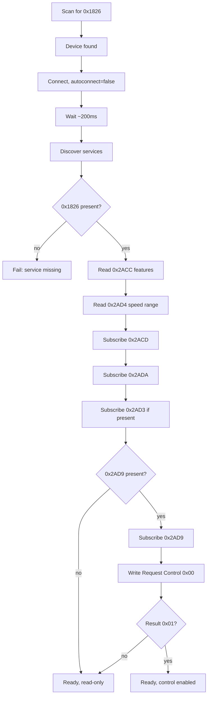

# Phase 00 — Probe App

> **This phase makes the treadmill answer questions. It doesn't build the product.**
> Every screen here is a test tool. It doesn't need to look good. It needs to show
> the bytes correctly.

**Treadmill needed:** yes, at the end · **Size:** L · **Blocks:** everything

---

## Goal

An Android app on your phone that can:

1. Find the treadmill and connect to it.
2. List every Bluetooth service and characteristic, and show each readable one as hex.
3. Listen to every characteristic that sends updates, and log each packet as
   `time | uuid | hex`.
4. **Send any bytes to the control point `0x2AD9` and show the reply**, using preset
   buttons or a free-text hex box.
5. **Record what happened**: save the session to a file, and let you mark an entry
   as "this was correct" with a note.
6. **Keep recording with the screen off**, using a small background service. This
   tests the one big risk of using Expo, on the real treadmill, before any product
   code depends on it.

After this phase, "what should we send to the treadmill?" is answered by testing, not
by trusting the spec.

## Why it's built this way

The treadmill's Bluetooth chip is made by FitShow, and its standard (FTMS) layer is
known to lie: its feature list (`0x2ACC`) says it has an incline, and it doesn't. So
the first thing to build is a tool that shows exactly what the chip does. That tool's
output becomes the spec.

Goal 6 is the same idea, for the phone instead of the treadmill. React Native runs
your code on one JavaScript thread, and Android pauses that thread's timers when the
screen is off. A background service might fix that. Phase 00 finds out on day one
instead of in Phase 14.

---

## Read first

- The protocol reference below. **The control point section is what this phase is
  built around.** Decoding the data stream is Phase 01, not this phase.
- [`HUMAN-RUNBOOK.md`](HUMAN-RUNBOOK.md): the steps you'll follow on the treadmill.
- [`PHASE-00-FINDINGS.md`](PHASE-00-FINDINGS.md): what's already measured. Everything
  marked NEEDED is a target.
- [`../../docs/learning/00-Expo-And-React-Native.md`](../../docs/learning/00-Expo-And-React-Native.md):
  the "screen off" section explains why task 0.12 exists.

---

## Protocol reference: characteristics and control point

> Just the part of the FTMS protocol this phase needs. The full byte-by-byte
> reference is in [`../phase-01-protocol-decode/README.md`](../phase-01-protocol-decode/README.md).

### FTMS characteristics

| UUID | Name | What you can do |
|------|------|-----------------|
| `0x2ACC` | Fitness Machine Feature | Read |
| `0x2ACD` | Treadmill Data | Notify (it sends updates) |
| `0x2AD3` | Training Status | Read, Notify |
| `0x2AD4` | Supported Speed Range | Read |
| `0x2AD9` | Fitness Machine Control Point | Write, Indicate (it replies) |
| `0x2ADA` | Machine Status | Notify |

There are also `1800` (Generic Access), `180A` (Device Information), `180D` (Heart
Rate), and FitShow's own `FFE0`/`FFF0`. Those last two are only recorded, never used.

### Control point (`0x2AD9`) commands

The only characteristic you write to. **Do these steps in order.** Skipping one is
the usual reason commands silently do nothing.

1. **Turn on replies** for `0x2AD9`. (Technically: write `0x0002` to its `0x2902`
   descriptor. The library does this for you.)
2. **Send `Request Control` (`00`)** and wait for a "success" reply.
3. Only then send other commands, always with **Write With Response**.
4. **One command at a time**: wait for the reply (up to 3 seconds) before the next.

| Command | Bytes | Notes |
|---------|-------|-------|
| Request Control | `00` | Must succeed first |
| Reset | `01` | |
| Set Target Speed | `02 LL HH` | Speed in hundredths of km/h, low byte first |
| Set Target Inclination | `03 LL HH` | Not used: no incline on this machine |
| Start or Resume | `07` | |
| Stop or Pause | `08 01` (stop) / `08 02` (pause) | **The second byte is required** |

Example: 6.5 km/h → 650 → hex `028A` → bytes `02 8A 02` (low byte `8A` first).

**The reply** comes back as an indication: `80` (always), then the command it's
answering, then a result code.

| Result | Meaning |
|--------|---------|
| `0x01` | Success |
| `0x02` | Command not supported |
| `0x03` | Invalid value |
| `0x04` | Operation failed |
| `0x05` | Control not allowed |

How the real app handles each result is in
[`../phase-05-treadmill-control/README.md`](../phase-05-treadmill-control/README.md).

### Connection sequence

Read features and speed range *before* subscribing. Subscribe to the control point
*before* writing to it. After connecting, ask for bigger packets:
`BleManager.requestMTU(id, 517)` (the default only fits 20 bytes).

In library terms: `connect(id, { autoconnect: false })`, wait, `retrieveServices(id)`,
`read(...)`, `startNotification(...)`, `write(...)`. `startNotification` handles both
"notify" and "indicate" characteristics.

---

## Technology decisions

> One developer, for years. Every library has to be worth what it costs to learn and
> keep working. Checked against the libraries' state in October 2026.

### Expo (React Native), development build, Android only

**Problem.** The app needs a real Android UI, Bluetooth that keeps working with the
screen locked, and a local database, built by one person who knows TypeScript and has
used Expo, but is new to Bluetooth and Android.

**Why this.** The only new things are the things this project is about: Bluetooth,
the protocol, and Android's background rules. The language, React and the tools are
already familiar.

- **Development build, not Expo Go.** Expo Go only includes a fixed set of native
  libraries, and the Bluetooth library isn't one. A development build is your own
  version of Expo Go with the libraries you need. You build it once; after that,
  editing code works just like Expo Go.
- **No hand-edited `android/` folder.** Expo generates it from `app.json` on every
  build. Native settings stay in one readable file. The one piece of custom Kotlin
  (the background service) lives in `src/modules/` and is committed.

**Alternatives.**

1. **.NET MAUI** (the old plan). Good: one language, and the connection can live in a
   real Android service, so the "does JavaScript keep running?" question disappears.
   Bad: C# was new to you, so its main advantage is gone. Better when you already
   know C#.
2. **Kotlin + Jetpack Compose.** Good: no layers in between, the simplest background
   story, the most Bluetooth tutorials. Bad: a new language and a new UI toolkit at
   once. Better when Android-specific code dominates, which is also the fallback if
   Part H fails.
3. **Flutter.** Good: solid Bluetooth library. Bad: a new language, and the same
   background problem as React Native. Better for a team that already writes Dart.
4. **React Native without Expo.** Good: one less layer. Bad: you maintain the
   `android/` folder by hand, and every upgrade means merging changes into it. Better
   when an app needs deep native changes all the time.

**Why not those.** MAUI's advantage didn't apply. Kotlin costs the most to learn and
stays the fallback. Flutter is a new language with the same problem. Plain React
Native gives up the generated `android/` folder for nothing.

**Long term.** Expo releases about three versions a year. Upgrade on purpose, one
version at a time. Debugging Bluetooth now crosses two layers (your TypeScript, the
library's Java), and background JavaScript is a known weak spot, which is why task
0.12 and Part H exist. `src/core/` is plain TypeScript and would move to anything.

**In the code:** the whole `src/` project. `npx expo run:android --device` builds it.

### `react-native-ble-manager`

**Problem.** Raw Android Bluetooth is a lot of callback code, and it's where the
nasty bugs live (like the famous GATT error 133). TypeScript can't reach it at all
without a native library.

**Why this.** Version 12.5.3 (September 2026) is actively maintained, built for React
Native's current architecture, and its Expo plugin works with this Expo version. Its
Android code already does several things this phase needs: it queues Bluetooth
operations one at a time, closes old connections properly (the main fix for error
133), and reports the error code when a connection drops. Data arrives as plain
arrays of bytes.

**Alternatives.**

1. **`react-native-ble-plx`.** Good: the best-known option, lots of tutorials. Bad: no
   release since February 2026, no support for the current architecture, and its Expo
   plugin breaks builds on Expo 56 and later. Better if it gets a fixed release.
2. **A fork of ble-plx (`@sfourdrinier/...`).** Good: rewritten for the current
   architecture. Bad: one maintainer, a few months old. Better once it has a track
   record. It's the first place to look if ble-manager stops being maintained.
3. **Writing our own Bluetooth module in Kotlin.** Good: full control, and Bluetooth
   could live inside the background service. Bad: hundreds of lines of tricky Kotlin.
   Better only if Part H fails.

**Why not those.** ble-plx needs patching just to build. The fork is too new. Our own
module is the most work and only makes sense if Part H fails.

**Long term.** The main risk is a future React Native upgrade breaking it. Upgrading
one version at a time catches that early. Only `src/features/bluetooth/` imports the
library, so swapping it touches one folder. (The Phase 00 test screens use it directly
too, which is fine for test tools.)

**In the code:** `src/features/bluetooth/bleClient.ts` (task 0.4).

### Expo Router

**Problem.** The app needs to move between screens, with a working back button.

**Why this.** It comes with Expo's default template, and a screen is just a file:
`src/app/diagnostics/scan.tsx` is the `/diagnostics/scan` screen. Nothing to register.
It's built on React Navigation, so the back button and screen stack just work.

**Alternatives.**

1. **React Navigation directly.** Good: what Expo Router is built on; routes in code.
   Bad: you register every screen by hand. Better if you prefer routes in code.
2. **One screen with a `useState` switch.** Good: no library. Bad: you build the back
   button and history yourself. Fine for six test screens, not for the full app.
3. **`react-native-navigation`.** Good: fully native screens. Bad: heavy and awkward
   with Expo. Better only in big apps already using it.

**Why not those.** Expo Router is React Navigation without the registration step.

**Long term.** Maintained by Expo, updated with each version. Low risk.

**In the code:** `src/app/_layout.tsx`, `src/app/index.tsx`, `src/app/diagnostics/*.tsx`.

### Jest, plus `node:sqlite` for database tests

**Problem.** The parsers, the workout logic and the database code need tests that run
on the PC, without a phone.

**Why this.** Jest is what Expo's own testing guide uses, and its fake timers let you
test something that runs once a second (or waits 60 seconds) instantly. The phone's
database library can't run on a PC, so the database code talks to a small `Db`
interface with two versions: one for the phone (`expo-sqlite`) and one for tests
(Node's built-in SQLite, no extra install).

The phone version has a second job. It sends every query through one queue on **one**
connection. That matters because `expo-sqlite`'s "exclusive transaction" feature opens
a second connection that doesn't have the `foreign_keys` setting turned on, so
"delete a workout and its samples" would quietly leave the samples behind.

**Alternatives.**

1. **Vitest.** Good: faster. Bad: not what Expo's tools expect. Better for pure
   TypeScript libraries.
2. **`better-sqlite3` for tests.** Good: very stable. Bad: has to compile on install,
   and Node already includes SQLite. Better if `node:sqlite` changes (it's still
   marked experimental).
3. **Testing the database only on the phone.** Good: tests the real thing. Bad: slow,
   and needs the phone every time. Used only for performance numbers, in Phase 12.

**Why not those.** Speed we don't need, a build step we don't need, and a slow loop.

**Long term.** Jest is standard. The `Db` interface is six methods, and pays for
itself in Phase 06.

**In the code:** `src/core/ftms/ftmsCommands.test.ts`,
`src/core/data/testing/nodeSqliteDb.ts`, `src/features/data/expoDb.ts`.

---

## Scope

**In this phase:** project setup, permissions, scan, connect, service list, hex
reads, notification log, control-point console, capture files, the guided checklist,
the database setup (no tables yet), and **the keep-alive test** (task 0.12).

**Not in this phase:** decoding the data (Phase 01; this phase shows *hex* only),
reconnecting automatically (Phase 02), the dashboard, workouts, and the finished
background service (Phase 07 finishes what 0.12 starts).

> **One exception to "no decoding":** the control-point *reply* is decoded. Seeing
> `80 00 01` you need to know right away that it means "Request Control: success".
> That's a three-line lookup, not a parser.

---

## Tasks

Do [`TASKS.md`](TASKS.md) in order:

| # | Task | Result |
|---|------|--------|
| 0.1 | Project setup | Expo app on the phone, navigation, tests, lint rule, theme |
| 0.2 | Permissions + Bluetooth on/off | Asks for Bluetooth permissions, handles every case |
| 0.3 | Scan screen | Device list, signal strength, filters, raw advert bytes |
| 0.4 | Connect + discovery | Service list screen, bigger packets |
| 0.5 | Read dump screen | Every readable value as hex, copy button |
| 0.6 | Notification log screen | Live `time \| uuid \| hex`, rate, gap meter |
| 0.7 | **Control console** | Preset buttons + free hex, decoded reply |
| 0.8 | Capture recorder | Session files, share, mark entries as correct |
| 0.9 | Guided checklist | Runbook Parts A–H as a form; exports markdown |
| 0.10 | Log files | Logs to logcat and to files you can share |
| 0.11 | Database setup | Database file, migration runner, test database |
| 0.12 | **Keep-alive test** | Background service + keep-alive task, heartbeat in the log |

---

## Deliverables

1. **The app on your phone**, plus a release build that runs without the PC.
2. **Six working screens**: Scan, Service list, Read dump, Notification log, Control
   console, Checklist.
3. **At least one real capture file** committed to `captures/` after the treadmill
   session.
4. **`PHASE-00-FINDINGS.md` updated** with every answer, the verdicts, and the "Still
   unresolved" table. That table is the project's one list of open questions.

---

## Automated tests

There's little to test here: this phase is mostly input and output. Test the parts
that are pure logic, all in `src/core/` (`npm test`):

- Hex text ↔ bytes, including odd lengths and extra spaces.
- Command builder: `setTargetSpeed(6.5)` gives `02 8A 02`. Check every example from
  the command table above.
- Reply decoder: `80 00 01` → Request Control, Success. `80 02 03` → Set Target
  Speed, Invalid value. A too-short reply is rejected without crashing.
- Capture lines: one valid JSON object per line, hex uppercase with spaces.
- Migration runner (using the test database): creates `SchemaVersion`, and running
  it twice changes nothing.

## Treadmill tests

See [`HUMAN-RUNBOOK.md`](HUMAN-RUNBOOK.md). The agent stops here and waits for your
results.

---

## Done when

- [ ] `npx tsc --noEmit` and `npx expo lint` are clean; `npm test` passes.
- [ ] The app launches on the phone and creates its database file.
- [ ] A release build installs and runs with the PC unplugged.
- [ ] The treadmill shows up in 5 out of 5 scans.
- [ ] It connects and lists the services.
- [ ] Every readable value shows as hex and can be copied.
- [ ] The notification log records `0x2ACD` packets with times.
- [ ] The console sends `00` and shows the raw reply **and** what it means.
- [ ] A capture file is committed to `../../captures/`.
- [ ] `PHASE-00-FINDINGS.md` clearly answers:
      - **V1 counters**: reset per session, or keep counting? (blocks Phase 06)
      - **V2 control**: does it obey commands? (decides Phase 05)
      - **V3 heart rate**: usable, marginal, or cut
      - **V5 screen off**: does the keep-alive hold? (decides Phase 07)
      - Raw hex for `0x2ACC` and `0x2AD4`
      - Notification rate, packet size (MTU), MAC address and type, whether `0x1826` is advertised
- [ ] Nothing marked NEEDED in the findings that this session could have answered.

---

## "Record what's correct", concretely

| Level | How |
|-------|-----|
| Raw | Every byte in and out, with a time, to a file. No interpretation. |
| Marked | Tap an entry → "Confirm" + a note ("belt actually started here"). |
| Concluded | The checklist (0.9) → verdicts → markdown → pasted into `PHASE-00-FINDINGS.md`. |

The raw level matters most. You can always work out a verdict again from raw bytes.
You can't get raw bytes back from a note that says "worked".

---

## Traps

- **Turn on replies for `0x2AD9` before writing to it** (`startNotification` first).
  This is the most common reason "the control point does nothing".
- **Send `Request Control` first**, and again after every reconnect.
- **Send one control command at a time.** The library queues Bluetooth operations,
  but it can't know a command isn't finished until the reply arrives. Wait for the
  reply (3 seconds max) yourself.
- **Use `BleManager.write`**, never `writeWithoutResponse`.
- **Stop and Pause need their second byte:** `08 01` and `08 02`. `08` alone is wrong.
- **GATT error 133 will happen.** The library already closes old connections. You
  still connect with `autoconnect: false` and wait ~200 ms before `retrieveServices`.
  Log every disconnect's status number. `adb logcat -s RNBleManager` shows the
  library's own logs.
- **UUIDs come back in different spellings** (`2acd`, or the long
  `00002acd-0000-1000-8000-00805f9b34fb`). Convert them once, when they arrive, to the
  `2ACD` form the captures use.
- **Android limits scans to about 5 every 30 seconds**, then silently returns nothing.
  Don't let the scan button restart in a loop.
- **Timers stop when the screen is off** unless task 0.12's keep-alive is running.
  Bluetooth data still arrives; `setTimeout` doesn't fire. Don't work around it some
  other way: that's exactly what Part H measures.
- **Don't decode `0x2ACD` here.** A decoded number you half-believe is worse than hex
  you have to read. Decoding is Phase 01.

---

## Safety

The console can start the belt. Every command that can move it (`07` Start, and `02`
Set Target Speed while stopped) asks for confirmation. The console screen always
shows:

> The physical safety key is the emergency stop. This app is not.

---

## Definition of done

You can hand back a file that says what this treadmill really does, and whether the
phone keeps listening with the screen off. Phase 01 can then be written against real
bytes.
