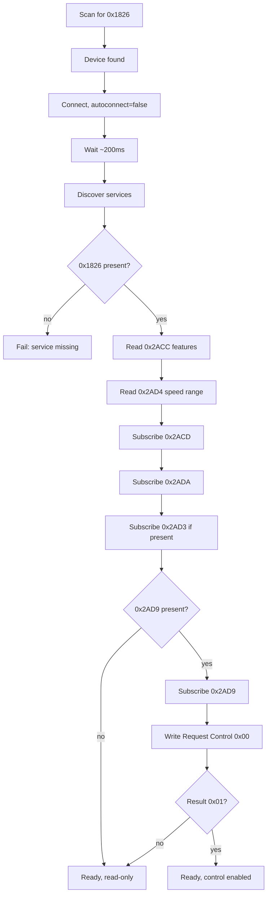
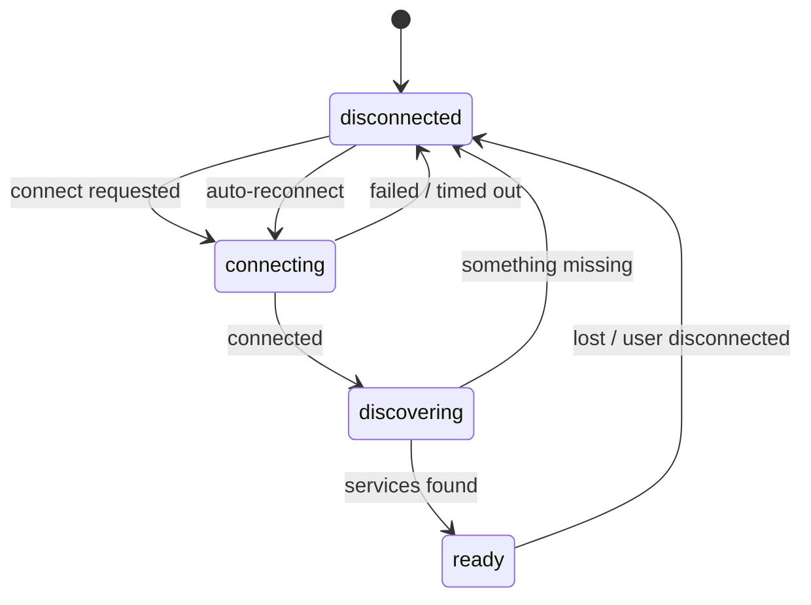

# Phase 02 — Stay Connected

> Phase 00 connects once, by hand. This phase makes the app stay connected, and
> reconnect on its own when the connection drops.

**Treadmill needed:** yes · **Size:** M · **Waits for:** Phase 01

---

## Goal

A connection that survives real life: walking out of range, Bluetooth being turned
off and on, the treadmill being switched off, and the app restarting.

### The idea

Right now, if the connection drops, you have to go to a test screen and reconnect by
hand. For an app that sits on the treadmill while you walk, that's not good enough.
This phase makes it reconnect by itself, like wireless earbuds do when you walk back
into range.

**Why not just retry straight away, forever?** Two reasons. Hammering Android's
Bluetooth with back-to-back attempts makes the infamous error 133 *more* likely, not
less. And retrying non-stop drains the battery when the treadmill is simply switched
off. So the app waits a bit longer after each failed try: 1 s, 2 s, 4 s, 8 s, 16 s,
then every 30 s. Quick when you've only stepped away, gentle when the treadmill is off.
That's one small function, `delayForAttempt` (task 2.2).

**The name for this:** *exponential backoff*. Wait longer after each failure. It's used
anywhere a program talks to something unreliable, not just Bluetooth.

**One more design choice:** the retry logic goes in a new class,
`ReconnectionManager`, that wraps Phase 00's `TreadmillConnection`. We don't edit
`TreadmillConnection` itself. Its job is "connect once, cleanly", and it already works.
Keeping the retries separate means a bug in them can't break the part that works. The
cost is one extra layer to go through.

**One thing this phase can't fix yet.** The waiting uses `setTimeout`. With the screen
off and no keep-alive running, timers don't fire (see Phase 00, task 0.12). So a drop
while the phone is locked won't start reconnecting until you unlock it. That's
expected for now; Phase 07 fixes it. Test this phase with the screen on.

## What you'll learn

- **Wrapping instead of editing** working code.
- **Exponential backoff.**
- **`AbortController`/`AbortSignal`**: the standard way to cancel async work. You'll
  write a small `sleep(ms, signal)` that stops waiting the moment it's cancelled.
- **`useSyncExternalStore`**: React's hook for showing a value that lives outside
  React. Task 2.7 uses it for the connection state.
- **Where code goes:** the delay schedule has no Bluetooth in it, so it goes in
  `core/` with a real test.
- New glossary words: exponential backoff, GATT 133, AbortSignal.

## Read first

- The connection sequence and error codes below.
- Phase 00's Traps section (GATT 133).
- `PHASE-00-FINDINGS.md`: Part E results, MAC and address type.
- **kv-store**: the "Key-value storage" section of
  https://docs.expo.dev/versions/latest/sdk/sqlite/. Simple saved values; task 2.1
  uses it to remember the last device.
- **`AbortController`**: https://developer.mozilla.org/en-US/docs/Web/API/AbortController
- **`useSyncExternalStore`**: https://react.dev/reference/react/useSyncExternalStore.
  Read "Subscribing to an external store".
- **Retry pattern**: https://learn.microsoft.com/en-us/azure/architecture/patterns/retry.
  Why backoff exists, not just the numbers.
- **ble-manager docs**: https://innoveit.github.io/react-native-ble-manager/. Check
  whether `connect(id)` works for a device that hasn't been scanned this session.

---

## Connection sequence



**Order matters.** Read features and speed range *before* subscribing, so the screen is
set up before data arrives. Subscribe to the control point *before* writing to it.

**Packet size (MTU).** By default a packet holds 20 bytes. A full `0x2ACD` packet can be
bigger, and then the treadmill splits it. Ask for bigger packets after connecting
(`BleManager.requestMTU(id, 517)`), but the parser must still handle split packets.
Phase 00's findings record what actually happens.

## App error codes

These are the app's own codes. They're separate from the treadmill's control-point
result codes (Phase 05).

| Code | Meaning | What the user sees |
|------|---------|--------------------|
| 1001 | Bluetooth is off | Prompt to turn it on |
| 1002 | Permission denied | Link to app settings |
| 1003 | Treadmill not found | Scan again |
| 1004 | Connection timed out | Try again |
| 1005 | Bluetooth error (incl. 133) | Retry with backoff |
| 1006 | FTMS service missing | Device not supported |
| 1007 | A needed characteristic is missing | Device not supported |
| 1008 | Subscribing failed | Reconnect |
| 1009 | Control write failed | Retry once |
| 1010 | Control not granted | Request control again |
| 1011 | No reply from control point | Retry once |
| 1012 | Bad packet | Logged only, not shown |

---

## Features

- Connect / disconnect
- **Remember the last device** by MAC address, **unless** Phase 00 found the address
  changes (random). Then match by name, and change the MAC index in Phase 06's schema
- Reconnect automatically: wait 1, 2, 4, 8, 16 seconds, then every 30. **It can be
  cancelled, and it never hammers**
- Show the connection state on screen
- Find the treadmill using whichever filter Phase 00 proved works (`0x1826` or the
  `FS-` name). **Just one.** Write down why in `PHASE-00-FINDINGS.md`

## Tasks

2.1 and 2.2 are small. 2.3 is the main task. 2.4–2.6 build on it. 2.7 is a small hook
(yours) plus UI (given).

### 2.1 — Remember the last device

1. Check the **Address type** row in `PHASE-00-FINDINGS.md`. `public` means the MAC is
   stable: use it. `random` (or still unknown) means match by name (`FS-9F4235`).
   Save both either way.
2. Create `src/features/bluetooth/lastDevice.ts` with two functions using `Storage`
   from `expo-sqlite/kv-store` (like `localStorage`, but it survives restarts).
3. `saveLastDevice(id, name)` saves both as JSON under one key, e.g.
   `"bluetooth.lastDevice"`. `loadLastDevice()` returns `{ id, name }` or `null`.
   `getItemSync` returns `null` if nothing was saved. Wrap `JSON.parse` in `try`, and
   treat bad data as "nothing saved", never a crash.
4. Call `saveLastDevice` when the connection reaches `ready` (in Phase 00's
   `useScan.ts`, right after `connect` finishes).
5. `ReconnectionManager` (2.3) calls `loadLastDevice()` at startup.

### 2.2 — The delay schedule, as a tested function

`ReconnectionManager` uses the Bluetooth library, so it can't be tested on the PC. The
delay schedule can.

1. Create `src/core/bluetooth/reconnectBackoff.ts`:
   ```ts
   /** How long to wait before attempt number `attempt`, in milliseconds. */
   export function delayForAttempt(attempt: number): number {
     // TODO: 1 -> 1000, 2 -> 2000, 3 -> 4000, 4 -> 8000, 5 -> 16000, 6 or more -> 30000
     // TODO: attempt below 1, or not a whole number: throw a RangeError
   }
   ```
2. Create `reconnectBackoff.test.ts`: a `test.each` for attempts 1–5, plus 6 and 20
   (both 30000), plus `0` and `1.5` (both throw).
3. `npm test`.

### 2.3 — `ReconnectionManager`

**The idea.** `TreadmillConnection` knows how to connect once. This new class decides
*when* to try again: notice a drop you didn't ask for, wait, try again, and stop when
told to.

**What it does:**

- Lives in `src/features/bluetooth/reconnectionManager.ts`.
- Takes the `TreadmillConnection` and the logger.
- `getState()` returns the connection's state. `onStateChange(listener)` passes on
  every state change, so nobody has to listen to both classes.
- A `userInitiatedDisconnect` flag: `true` while *you* are disconnecting, so the app
  doesn't reconnect after you asked it to stop.
- On a `disconnected` you didn't ask for: start the retry loop. On `ready`: stop it.
- The loop can be cancelled with an `AbortController`, created fresh each time, and
  aborted by `disconnect()` and `dispose()`.
- A small `sleep(ms, signal)` in `src/core/shared/sleep.ts` that waits, and gives up
  immediately (clearing its timer) when the signal is aborted. Test it with fake timers.
- **Your call:** how does it find the treadmill to reconnect to? Try `connect(id)` with
  the saved MAC directly. If that doesn't work for a device not scanned this session,
  do a short filtered scan (task 2.6's filter) and connect to the match. Write one line
  saying which you chose and why.

An outline:

```ts
export class ReconnectionManager {
  private backoff: AbortController | null = null;
  private userInitiatedDisconnect = false;
  private readonly stateChanges = createEmitter<ConnectionState>();
  private readonly unsubscribeInner: Unsubscribe;

  constructor(
    private readonly connection: TreadmillConnection,
    private readonly log: Logger,
  ) {
    this.unsubscribeInner = connection.onStateChange((state) => this.onInnerStateChange(state));
  }

  getState(): ConnectionState {
    return this.connection.getState();
  }

  onStateChange(listener: (state: ConnectionState) => void): Unsubscribe {
    return this.stateChanges.subscribe(listener);
  }

  private onInnerStateChange(state: ConnectionState): void {
    this.stateChanges.emit(state);

    if (state === 'disconnected' && !this.userInitiatedDisconnect) {
      // TODO: abort any old loop, start a new one. Don't await it, but add .catch() to log errors
    } else if (state === 'ready') {
      // TODO: connected: abort the loop if it's running
    }
  }

  private async runBackoffLoop(signal: AbortSignal): Promise<void> {
    // TODO: for attempt 1, 2, 3...: sleep(delayForAttempt(attempt), signal),
    // find the device, try to connect. Success: return. Failure: log, next attempt.
    // If sleep is cancelled, just return.
  }

  async disconnect(): Promise<void> {
    this.userInitiatedDisconnect = true;
    this.backoff?.abort();
    try {
      await this.connection.disconnect();
    } finally {
      this.userInitiatedDisconnect = false;
    }
  }

  dispose(): void {
    this.unsubscribeInner();
    this.backoff?.abort();
  }
}
```

**Add it** to the services file as `reconnection`, after the `TreadmillConnection`.

**Review:** go through the state diagram below with the agent. Does every arrow have a
matching line in your code?

### 2.4 — Check the GATT 133 fixes are still in place

No new code. Reconnecting calls `connect` over and over, so make sure the Phase 00
fixes still hold.

1. In `treadmillConnection.ts` and `bleClient.ts`: `connect` uses
   `{ autoconnect: false }`, and there's a ~200 ms wait before `retrieveServices`.
2. The third fix ("close the old connection, not just disconnect") is inside the
   library. Read it once so you know it's true: in
   `node_modules/react-native-ble-manager/android/src/main/java/it/innove/Peripheral.java`,
   `onConnectionStateChange` calls `gatt.disconnect()` then `gatt.close()`.
3. If 133 still shows up in the tests below, try `BleManager.refreshCache(id)` next
   (it clears Android's saved service list). Write down what helped in
   `PHASE-00-FINDINGS.md`. Don't assume the first fix you try is the answer.

### 2.5 — Request control again after reconnecting

The treadmill forgets who has control when the connection drops. Any button left
enabled after a reconnect would silently do nothing. Build the fix now; Phase 05 proves
it.

1. Pass Phase 00's `ControlPointClient` into `ReconnectionManager`.
2. When a drop happens, remember whether you had control (`hadControl`).
3. After reconnecting, if you had control: turn replies on for `0x2AD9` again
   (`startNotification`), then `requestControl()`.
4. Check it again in Phase 05, once there's a real control screen.

### 2.6 — Pick the scan filter

1. Check Finding **V4**. "Yes" (`0x1826` advertised) means filter by service UUID. "No"
   means filter by the `FS-` name.
2. Use that filter wherever `ReconnectionManager` scans. Never scan without a filter
   here. (The Phase 00 scan screen keeps all three options for testing.)
3. Write the decision and why in `PHASE-00-FINDINGS.md`. One sentence is enough.

### 2.7 — Show the connection state

The gray theme shows "connected" as a filled dot and "not connected" as an empty one.
No colors.

**The hook (yours):** `src/features/bluetooth/useConnectionState.ts`

```ts
export function useConnectionState(): ConnectionState {
  const { reconnection } = useServices();
  // TODO: return useSyncExternalStore(subscribe, getSnapshot), where subscribe uses
  // reconnection.onStateChange and getSnapshot is reconnection.getState.
  // Question for the review: why must `subscribe` be the same function every render?
}
```

**The UI (given):** add this near the top of the home screen (`src/app/index.tsx`):

```tsx
import { ConnectionDot } from '@/features/shared/theme/ConnectionDot';
import { Text } from '@/features/shared/theme/Text';
import { useConnectionState } from '@/features/bluetooth/useConnectionState';

function ConnectionRow() {
  const state = useConnectionState();
  return (
    <View
      style={{ flexDirection: 'row', alignItems: 'center', justifyContent: 'center', gap: 8, marginBottom: 12 }}
      accessible
      accessibilityLabel={`Treadmill ${state}`}
    >
      <ConnectionDot connected={state === 'ready'} />
      <Text variant="caption">{state}</Text>
    </View>
  );
}
```

Filled dot = `ready`. Empty dot = anything else. The text just shows the state name;
friendlier wording ("Reconnecting in 4 s…") comes in Phase 03.

Run it and turn phone Bluetooth off and on. The dot should go empty, then fill again.

## Connection states



**This is separate from the workout states** (Phase 04). Both run at the same time.
One combined diagram couldn't show "connection lost mid-workout", which is the most
likely real problem.

---

## Traps

- **GATT error 133** is Android's catch-all Bluetooth error. Known fixes: close the old
  connection before reconnecting (the library does this), use `autoconnect: false`,
  and wait ~200 ms before discovering services. *Expect it anyway; which fix works is
  found by testing.*
- Discovering services right after connecting fails on some phones. Wait first.
- Never start a second connect while one is running. `TreadmillConnection`'s queue
  prevents it; don't go around it.
- **No pairing.** Not needed.
- After reconnecting, **request control again** before enabling any control button.
- **An `async` function you don't `await` loses its errors** unless you add
  `.catch()`. The retry loop is started that way, so catch and log its errors.
- Signal at the walking spot is about −49 dBm, which is strong. **A drop there is a
  software problem, not a range problem.**

---

## Tests

| Test | Expected | |
|------|----------|---|
| Connect | Reaches `ready` within 10 s | treadmill |
| Disconnect | Disconnects cleanly, no reconnect attempt | treadmill |
| Walk out of range and back (screen on) | Reconnects by itself | treadmill |
| Phone Bluetooth off and on | Gets back to `ready` | treadmill |
| Restart the app | Reconnects to the saved treadmill | treadmill |
| Treadmill off and on | Reconnects once it's on | treadmill |
| Stay connected 30 min, idle | No drop | treadmill |
| Delay schedule | Unit test the delays and the 30 s cap | |
| `sleep` cancelled | Stops at once; no timer left (`jest.getTimerCount() === 0`) | |
| Cancel while waiting | Stops at once, nothing left running | |

## Done when

- [ ] Connects 10 times out of 10
- [ ] Recovers from all four disruption tests
- [ ] Retries are capped and can be cancelled
- [ ] The scan filter choice and its evidence are in `PHASE-00-FINDINGS.md`
