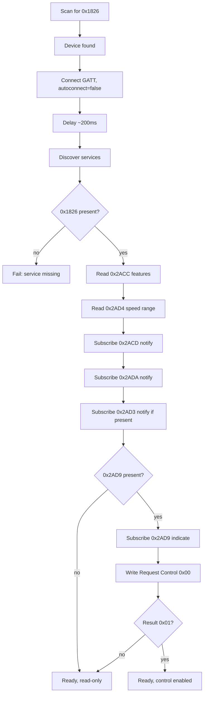
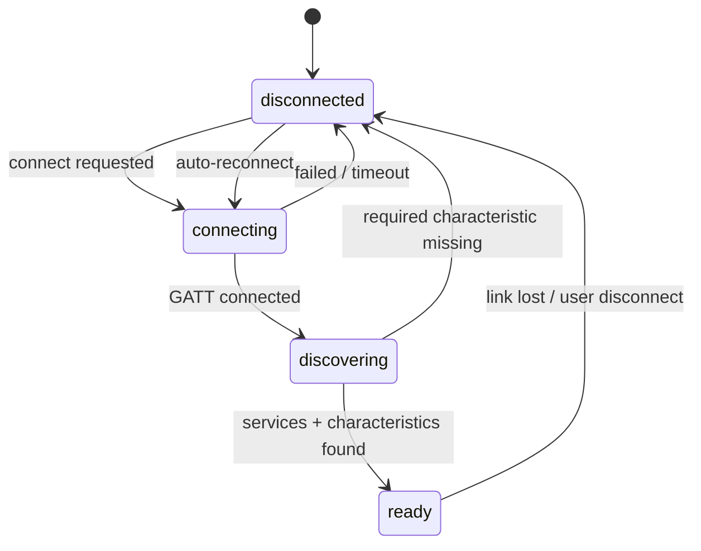

# Phase 02 — Connection Hardening

> Phase 00 connects once, by hand. This phase makes it stay connected, and come back
> on its own when it doesn't.

**Hardware:** required · **Size:** M · **Blocked by:** Phase 01

---

## Goal

A GATT connection that survives the real world: range loss, Bluetooth toggles,
treadmill power cycles, app restarts.

### Understanding what you're building (read this before the tasks)

**The problem.** Phase 00 built `treadmillConnection.ts`, and its own header comment
already says the honest thing: *"No auto-reconnect: that is Phase 02."* Right now,
walking off the side of the treadmill deck (RSSI ≈ −49 dBm at the walking position,
per the Traps section, a real, measured number, not a guess), toggling the phone's
Bluetooth, power-cycling the treadmill, or just restarting the app all leave you back
at a dead connection with no path forward except manually reconnecting through a
diagnostics screen. For an app meant to sit untouched on a treadmill console shelf
while you run, that's not acceptable. This phase turns "connects once, by hand" into
"stays connected, and comes back on its own," the way good wireless earbuds reconnect
automatically when you walk back into range instead of making you dig into settings.

**Why not just retry immediately, forever?** The simplest-sounding fix is: the
moment the connection reports `disconnected`, immediately call `connect` again, and
keep calling it in a tight loop until it works. That's *not* the approach this phase
takes, and the reason is concrete, not theoretical. GATT error 133 is already flagged
in the Traps section as "the single most common Android BLE failure," and hammering a
flaky radio stack with back-to-back connection attempts is a known way to make that
worse, not better. A tight retry loop also burns battery retrying a treadmill that
might be powered off or out of the room for the next twenty minutes, with the phone
screen off the whole time. The schedule this phase actually specifies (1 s, 2 s, 4 s,
8 s, 16 s, then a steady 30 s, cancellable and capped) is barely more code than a
naive `while (true)` retry loop (it's one pure function, `delayForAttempt`, task 2.2),
but it buys real behavior: fast recovery for the common case (you walked ten feet
away and came back), and a low, sustainable retry rate for the case where the
treadmill is genuinely off for a while. Nothing here reaches for more than that: no
jittered randomization, no configurable retry policies, no circuit breaker. A static
six-step schedule is the minimum shape that avoids both "hammering" and "gives up
forever," and this project needs nothing more elaborate than that.

**The pattern, named plainly.** The schedule itself is a textbook **Retry pattern
with exponential backoff**: wait progressively longer between attempts at
something that failed, on the reasonable assumption that a transient failure often
needs a little time to clear. It isn't BLE-specific; the same idea shows up
anywhere a client depends on something unreliable (HTTP calls to a flaky server,
background sync). The cost here is genuinely small: one pure, unit-testable
function. The payoff is specific to this project. A treadmill several feet away
with a phone in your pocket will drop and regain signal routinely during a
workout, and without this, every drop would otherwise require you to stop, look at
the phone, and manually reconnect mid-run.

There's a second, quieter pattern in how `ReconnectionManager` is built: it takes
a `TreadmillConnection` in its constructor and wraps it, rather than adding retry
logic inside `treadmillConnection.ts` itself. That's **composition over modifying
working code**, and the reasoning is Single-Responsibility-flavored.
`TreadmillConnection`'s one job is "connect once, cleanly," and that path is
already exercised by every Phase 00 screen. Bolting retry logic into the same
class means a bug in the *new* retry loop can now break the *already-proven*
connect-once path too. Keeping them as two classes, one wrapping the other, means
`ReconnectionManager` can misbehave without `TreadmillConnection` ever knowing it
exists. The tradeoff is real, not free: callers now go through one more layer
(`reconnectionManager.getState()` instead of the connection's directly), and that
layer has to remember to forward events it didn't originate (see the state-change
forwarding in the skeleton). For a class this small, wrapping is worth that one
extra layer of indirection; it would be overkill for, say, a one-line utility
function with no meaningful "known-working path" to protect.

**One thing this phase can't fix yet.** The backoff loop waits with `setTimeout`.
With the screen off and no keep-alive running, React Native's timers don't fire (see
Phase 00's task 0.12 and `docs/learning/00-Expo-And-React-Native.md`), so a
disconnect that happens while the phone is locked won't start reconnecting until the
screen comes back on. That's expected in this phase. Phase 07 runs the keep-alive
for every workout, which is what makes this loop work in your pocket. Test this
phase's disruption cases with the screen on.

## Learning goals

- **Composition over modifying working code.** `treadmillConnection.ts`'s own header
  says *"No auto-reconnect: that is Phase 02"*. You'll build the reconnect policy as
  a class that *owns* a `TreadmillConnection` rather than editing Phase 00's file in
  place, so a bug in the reconnect loop can never break the connect-once path every
  other screen already depends on.
- **Exponential backoff** as a general pattern, not a BLE-specific trick. You'll meet
  it again anywhere a client talks to something unreliable (HTTP retries, sync
  services). See the Retry pattern doc below.
- **`AbortController`/`AbortSignal`** for a cancellable async loop: the standard
  JavaScript way to say "stop now," applied here to "stop retrying." You'll write a
  small `sleep(ms, signal)` that rejects the moment the signal aborts, which is the
  piece that makes "cancel mid-wait" actually immediate.
- **`useSyncExternalStore`**: the React hook built for exactly "read a value that
  lives outside React and re-render when it changes." Task 2.7 uses it for the
  connection state, and Phase 03 uses the same shape for everything else.
- **Where code belongs, again.** The backoff *delay sequence* ("given attempt N, how
  long do I wait?") has no BLE dependency, so it's worth pulling into `core/` and
  giving a real Jest test, even though the class that uses it depends on ble-manager.
  Same test Phase 01b used ("does this import React Native or a native library?").
- New vocabulary for `docs/learning/02-Glossary.md` as you hit it this phase:
  "exponential backoff," "GATT 133," "AbortSignal."

## Reference docs

- The connection sequence and app error code reference below
- `../phase-00-probe-app/README.md`'s Traps section: GATT 133 mitigations
- `../phase-00-probe-app/PHASE-00-FINDINGS.md`: Part E resilience results, MAC and
  address type
- **`expo-sqlite/kv-store`**: the "Key-value storage" section of
  https://docs.expo.dev/versions/latest/sdk/sqlite/. A simple on-device key/value
  store with synchronous `getItemSync`/`setItemSync`; task 2.1 uses it to remember
  the last device. (Phase 00's probe checklist already uses it; Phase 08 has the
  full decision record.)
- **`AbortController`**: https://developer.mozilla.org/en-US/docs/Web/API/AbortController.
  The mechanism task 2.3's backoff loop uses to be "cancellable... no orphaned
  timer," per the Tests table below.
- **`useSyncExternalStore`**: https://react.dev/reference/react/useSyncExternalStore.
  Read the "Subscribing to an external store" section before task 2.7.
- **Retry pattern (exponential backoff)**: https://learn.microsoft.com/en-us/azure/architecture/patterns/retry.
  Not React Native-specific, but this project's 1/2/4/8/16/30 s schedule is exactly
  this pattern; worth reading *why* it exists, not just copying the numbers.
- **`react-native-ble-manager` docs**: https://innoveit.github.io/react-native-ble-manager/.
  Check whether `connect(id)` works for a device id that hasn't been seen in the
  current scan before deciding whether task 2.3 rescans or reconnects directly.

---

## Connection sequence reference



**Order matters.** Read the feature and range characteristics *before* subscribing,
so the UI is configured correctly by the time data starts arriving. Subscribe to the
control point *before* writing to it.

**MTU.** Default ATT MTU is 23 bytes, giving 20 bytes of payload. A fully-populated
Treadmill Data record can exceed that, in which case the machine splits it across
notifications using the More Data bit. Requesting a larger MTU
(`BleManager.requestMTU(id, 517)`) after connecting usually avoids this and is worth
doing, but the parser (Phase 01) **must still handle the split case correctly**
rather than assuming it won't happen. Negotiated MTU and whether the device ever
splits records is recorded in `../phase-00-probe-app/PHASE-00-FINDINGS.md`.

## Application error codes

App-level only. Distinct from the FTMS control point result codes in
`../phase-05-treadmill-control/README.md`.

| Code | Meaning | User-facing action |
|------|---------|--------------------|
| 1001 | Bluetooth disabled | Prompt to enable |
| 1002 | Permission denied | Link to app settings |
| 1003 | Device not found | Retry scan |
| 1004 | Connection timeout | Retry |
| 1005 | GATT error (incl. 133) | Retry with backoff |
| 1006 | FTMS service missing | Device unsupported |
| 1007 | Required characteristic missing | Device unsupported |
| 1008 | Notification subscribe failed | Reconnect |
| 1009 | Control point write failed | Retry once |
| 1010 | Control not granted | Re-request control |
| 1011 | Control response timeout | Retry once |
| 1012 | Malformed packet | Log and drop; not user-facing |

---

## Features

- Connect / disconnect
- **Remember last device**, by MAC, **unless** Phase 00 found a random resolvable
  address, in which case match by name and fix `UX_Device_MacAddress` in
  `../phase-06-recording-schema/README.md`
- Auto-reconnect with exponential backoff: 1 s, 2 s, 4 s, 8 s, 16 s, then 30 s steady.
  **Cancellable and capped**: do not retry forever with the screen off
- Connection state surfaced to the UI
- Production scan filter fixed to whichever of `0x1826` / `FS-` prefix Phase 00 proved
  works. **Ship one, not both**, and document why in `../phase-00-probe-app/PHASE-00-FINDINGS.md`

## Step-by-step

Seven tasks, roughly in build order. 2.1–2.2 are small and self-contained; 2.3 is the
real logic task (teach-don't-code applies); 2.4–2.6 extend it; 2.7 is a small hook
(yours) plus UI (written in full, per the collaboration model).

### 2.1 — Remember the last device

1. Open `../phase-00-probe-app/PHASE-00-FINDINGS.md`'s "BLE identity" table and check
   the **Address type** row. If it says `public`, MAC is a stable key; use it as
   primary. If it says `random resolvable` (or is still `NEEDED` when you reach this
   task), match by advertised name instead (`FS-9F4235`-style), per the note already
   in `../phase-06-recording-schema/README.md` next to `UX_Device_MacAddress`. Store
   both fields regardless, so you're not blocked either way.
2. Create `src/features/bluetooth/lastDevice.ts`: two functions wrapping
   `Storage` from `expo-sqlite/kv-store`, a simple on-device key/value store (think
   `localStorage`, but it survives app restarts and lives in the app's private
   storage). Exactly the right size for "which device to reconnect to," no table or
   migration needed.
3. `saveLastDevice(id: string, name: string | null): void` writes both under one key
   as JSON (e.g. `"bluetooth.lastDevice"`), and `loadLastDevice(): { id: string;
   name: string | null } | null` reads it back. `getItemSync` returns `null` when the
   key was never set; `JSON.parse` a corrupted value inside a `try`, and treat failure
   as "no remembered device," never a crash.
4. Call `saveLastDevice` once the connection reaches `ready`. Today that happens in
   Phase 00's `useScan.ts` connect handler; add the call right after the awaited
   `connect(...)`.
5. `loadLastDevice()` gets called from `ReconnectionManager` (task 2.3) on app start,
   to know which device to look for.

### 2.2 — Pull the backoff schedule into a pure, testable function

`ReconnectionManager` itself (task 2.3) depends on `TreadmillConnection`, which
depends on ble-manager, so it can't run in plain Node. The *delay sequence* has no
such dependency. Pull it out first.

1. Create `src/core/bluetooth/reconnectBackoff.ts`, a new `bluetooth/` folder in
   `core/`, alongside the existing `ftms/`, `capture/`, `data/`.
2. Shape:
   ```ts
   /**
    * Pure backoff-delay calculator: attempt 1 -> 1 s, 2 -> 2 s, 3 -> 4 s, 4 -> 8 s,
    * 5 -> 16 s, 6 and beyond -> 30 s steady. No BLE, no React Native: testable in Node.
    * Returns milliseconds, because that's what setTimeout takes.
    */
   export function delayForAttempt(attempt: number): number {
     // TODO: attempts 1-5 double from 1000 ms (1000, 2000, 4000, 8000, 16000);
     // attempt 6+ holds at 30000. attempt < 1 or a non-integer is a caller bug:
     // throw a RangeError.
   }
   ```
3. Create `src/core/bluetooth/reconnectBackoff.test.ts` with a `test.each` covering
   attempts 1 through 5 against the exact schedule, plus attempt 6 and attempt 20 both
   returning 30000, plus `0` and `1.5` throwing. This is the "Backoff schedule" row in
   the Tests table below.
4. `npm test`: green, including every earlier phase's tests (regression).

### 2.3 — Build `ReconnectionManager`

**Concept.** `TreadmillConnection` knows how to connect once and tear down cleanly.
Nothing in it decides *when* to try again. That decision (watch for an unrequested
disconnect, wait per `delayForAttempt`, try again, give up cleanly on cancel) is a new
class that sits in front of `TreadmillConnection`, not a change to it.

**Spec.**

- File: `src/features/bluetooth/reconnectionManager.ts`.
- Constructor takes the `TreadmillConnection` and the logger, plus whatever you decide
  in the design decision below for finding the remembered device.
- `getState()` returns the inner connection's state, and `onStateChange(listener)`
  re-emits every inner state change, so anything watching this class never has to
  also watch the class underneath it.
- A `userInitiatedDisconnect` flag, `true` for the duration of your own
  `disconnect()` wrapper and `false` otherwise. This is what tells the
  `disconnected` handler "don't reconnect, the user asked for this."
- On an *unrequested* `disconnected`, starts the backoff loop; on `ready`, stops it
  (success ends the loop).
- The backoff loop is cancellable: an `AbortController | null` field, recreated each
  time the loop starts, aborted by `disconnect()` and `dispose()`.
- A small `sleep(ms: number, signal: AbortSignal): Promise<void>` helper that clears
  its timer and rejects when the signal aborts. Put it in `src/core/shared/sleep.ts`
  and test it with fake timers; it's pure.
- **Design decision, yours to make**: how does the loop find the device to reconnect
  to? ble-manager's `connect(id)` may accept a remembered MAC directly, without a scan
  in this session (check the docs linked above, then try it). If so, use
  `loadLastDevice()`'s id and skip scanning entirely. If not, fall back to a short
  filtered scan (task 2.6 decides the filter) for the remembered id or name and
  connect to the first match. Either is defensible; write a one-line comment saying
  which you picked and why, same as Phase 01b's target-speed-after-Start decision.

Skeleton, shape only, not the working loop:

```ts
/**
 * Owns the "stay connected" policy on top of TreadmillConnection, which only knows
 * how to connect once. See docs/learning/02-Glossary.md for "exponential backoff"
 * if this is your first time meeting the term.
 */
export class ReconnectionManager {
  private backoff: AbortController | null = null;
  private userInitiatedDisconnect = false;
  private readonly stateChanges = createEmitter<ConnectionState>();
  private readonly unsubscribeInner: Unsubscribe;

  constructor(
    private readonly connection: TreadmillConnection,
    private readonly log: Logger,
  ) {
    this.unsubscribeInner = connection.onStateChange((state) => this.onInnerStateChange(state));
  }

  getState(): ConnectionState {
    return this.connection.getState();
  }

  onStateChange(listener: (state: ConnectionState) => void): Unsubscribe {
    return this.stateChanges.subscribe(listener);
  }

  private onInnerStateChange(state: ConnectionState): void {
    this.stateChanges.emit(state);

    if (state === 'disconnected' && !this.userInitiatedDisconnect) {
      // TODO: abort any previous backoff loop, then start a new one with a fresh
      // AbortController. Don't await it here: this is an event handler. Do attach
      // a .catch() so an unexpected error is logged instead of becoming an
      // unhandled promise rejection.
    } else if (state === 'ready') {
      // TODO: the loop succeeded (or was never needed): abort it if running
    }
  }

  private async runBackoffLoop(signal: AbortSignal): Promise<void> {
    // TODO: attempt = 1, 2, 3, ...
    //   await sleep(delayForAttempt(attempt), signal)
    //   find the device (see the design decision above), try this.connection.connect
    //   on success: return; on failure: log it, attempt++, loop again
    //   when sleep rejects because the signal aborted, just return: whoever aborted
    //   already knows the loop is stopping
  }

  async disconnect(): Promise<void> {
    this.userInitiatedDisconnect = true;
    this.backoff?.abort();
    try {
      await this.connection.disconnect();
    } finally {
      this.userInitiatedDisconnect = false;
    }
  }

  dispose(): void {
    this.unsubscribeInner();
    this.backoff?.abort();
  }
}
```

**Register it** in `src/features/services.tsx` as `reconnection`, created right after
the existing `TreadmillConnection`, same reasoning (one reconnect policy per running
app).

**Review checkpoint**: before task 2.7's UI wiring, walk through the state machine
diagram below with the agent against your actual code. Does every transition in the
diagram have a corresponding line in `onInnerStateChange`/`runBackoffLoop`?

### 2.4 — Confirm the GATT 133 mitigations are still in force

Not new code. `TreadmillConnection.connect` is about to get called repeatedly (by the
backoff loop) instead of once by hand, so it's worth re-checking the Phase 00
mitigations still hold.

1. Open `src/features/bluetooth/treadmillConnection.ts` and `bleClient.ts` and confirm
   two things are still true: `connect` passes `{ autoconnect: false }`; there's a
   ~200 ms wait between connecting and `retrieveServices`.
2. The third mitigation ("always `close()` the `BluetoothGatt` before reconnecting, not
   just `disconnect()`") lives inside ble-manager rather than in your code. Read it
   once so you know it's true rather than trusting this sentence:
   `node_modules/react-native-ble-manager/android/src/main/java/it/innove/Peripheral.java`,
   `onConnectionStateChange` (it calls `gatt.disconnect()` then `gatt.close()` on
   every disconnect or error status), and `disconnect(callback, force)` (closes when
   `force` is true, which is the JS-side default).
3. If GATT 133 shows up during the resilience tests below despite all three, treat it
   as empirical (per the Traps section). `BleManager.refreshCache(id)` (clears
   Android's cached service table) is the next thing worth trying. Record what changed
   it in `../phase-00-probe-app/PHASE-00-FINDINGS.md`; don't assume the first
   mitigation you try is *the* fix.

### 2.5 — Re-issue Request Control after reconnect

**Concept.** The Traps section already states the rule: the control point (`0x2AD9`)
forgets who has control across a GATT disconnect. A reconnect that silently leaves
"Start"/"Set Speed" enabled in some future UI is a bug, even though no such UI exists
yet outside the Phase 00 diagnostics console. Write the mechanism now, prove it later.

1. Give `ReconnectionManager` the `ControlPointClient` from Phase 00 (pass it into the
   constructor in `services.tsx`).
2. Track a `hadControl` flag, set from `controlPointClient.hasControl()` at the moment
   a disconnect is detected.
3. After a successful reconnect (state reaches `ready`) where `hadControl` was true,
   re-enable indications on `0x2AD9` (`startNotification`), the same thing the Phase 00
   console does on entry, then `requestControl()`.
4. This has nowhere to prove itself end-to-end until a real control screen exists
   (Phase 05); that's fine, the mechanism belongs here per the Traps section.
   Revisit it at that phase's review checkpoint.

### 2.6 — Fix the production scan filter

1. Open `../phase-00-probe-app/PHASE-00-FINDINGS.md`, verdict **V4**. "Yes" (0x1826 in
   the advertisement) means filtering by service UUID; "no" means the `FS-` name
   prefix.
2. In `ReconnectionManager`, wherever it scans to find the remembered device (task
   2.3's design decision), pass that filter explicitly. Never scan unfiltered on this
   path. The Phase 00 scan screen keeps all three modes for debugging; this is the one
   place the choice is hardcoded for real use.
3. Record the decision and its evidence in `../phase-00-probe-app/PHASE-00-FINDINGS.md`'s
   "BLE identity" table (the `0x1826 in advertisement?` row). A sentence is enough,
   e.g. "Confirmed present in the Phase 00 capture; production scan filters on
   0x1826."

### 2.7 — Surface connection state in the UI

The monochrome theme's "conveying state without color" pattern
(`docs/learning/04-Monochrome-Theme.md`) is built for exactly this: a filled-vs-outline
circle for connected/not, no second hue.

**The hook (yours).** Create `src/features/bluetooth/useConnectionState.ts`:

```ts
export function useConnectionState(): ConnectionState {
  const { reconnection } = useServices();
  // TODO: return useSyncExternalStore(subscribe, getSnapshot), where subscribe is
  // reconnection.onStateChange (adapted to React's `() => void` callback shape) and
  // getSnapshot is reconnection.getState. Two lines once you see it. The question
  // worth answering at review: why must `subscribe` be a stable function (defined
  // once, or wrapped in useCallback) rather than a new arrow on every render?
}
```

**The UI (written in full).** Phase 00's theme already has a `ConnectionDot`
component. Add this row near the top of the home screen (`src/app/index.tsx`), above
the list of destinations:

```tsx
import { ConnectionDot } from '@/features/shared/theme/ConnectionDot';
import { Text } from '@/features/shared/theme/Text';
import { useConnectionState } from '@/features/bluetooth/useConnectionState';

function ConnectionRow() {
  const state = useConnectionState();
  return (
    <View
      style={{ flexDirection: 'row', alignItems: 'center', justifyContent: 'center', gap: 8, marginBottom: 12 }}
      accessible
      accessibilityLabel={`Treadmill ${state}`}
    >
      <ConnectionDot connected={state === 'ready'} />
      <Text variant="caption">{state}</Text>
    </View>
  );
}
```

A filled dot means `ready`; an outline-only dot means anything else
(`disconnected`/`connecting`/`discovering`), no color, per the theme. The text just
prints the state name, good enough here; a friendlier label ("Reconnecting in 4 s…")
is a Phase 03 dashboard concern, not this one.

Build, run, and toggle phone Bluetooth off/on (one of the Tests rows below). Watch the
dot flip from filled to outline and back.

## Connection state machine



**This machine is independent of the workout state machine** (Phase 04). Both run
concurrently. A single combined diagram cannot express "connection lost mid-workout",
which is the most likely real failure.

---

## Traps

- **GATT error 133** is the single most common Android BLE failure and is generic
  enough to mean almost anything. Known-helpful mitigations: always `close()` the
  `BluetoothGatt` before reconnecting, not just `disconnect()` (ble-manager does this,
  task 2.4); use `autoconnect: false` on the first attempt; put ~200 ms between
  connect and service discovery.
  *Expect 133 to occur; treat which mitigation fixes it as empirical.*
- Discovering services immediately on connect fails on some stacks. Delay.
- Never start a second connect while one is in flight. `TreadmillConnection`'s promise
  chain (Phase 00) prevents it; don't bypass it from `ReconnectionManager`.
- **No bond handling.** Bonding is confirmed not required.
- On reconnect, **re-issue `Request Control`** before re-enabling any control UI.
- **An `async` event handler's rejection goes nowhere** unless you `.catch()` it.
  `onInnerStateChange` starts the loop without awaiting it, so the loop's own errors
  must be caught and logged inside it or at the call site.
- RSSI at the walking position is ≈ −49 dBm. **Any disconnect here is a software
  problem, not a radio one**: do not go looking for antenna explanations.

---

## Tests

| Test | Expected | |
|------|----------|---|
| Connect | Reaches `ready` within 10 s | `[HUMAN]` |
| Disconnect | Clean teardown, no reconnect attempt | `[HUMAN]` |
| Walk out of range and return (screen on) | Auto-reconnects | `[HUMAN]` |
| Toggle phone Bluetooth off/on | Recovers to `ready` | `[HUMAN]` |
| App restart | Reconnects to remembered device | `[HUMAN]` |
| Treadmill power-cycled | Reconnects once powered on | `[HUMAN]` |
| Hold connection 30 min idle | No spontaneous drop | `[HUMAN]` |
| Backoff schedule | Unit test the delay sequence and the cap | |
| `sleep` aborts | Rejects immediately on abort; no timer left pending (`jest.getTimerCount() === 0`) | |
| Cancel mid-backoff | Stops immediately, no orphaned timer | |

## Acceptance

- [ ] Connects on 10 of 10 attempts
- [ ] Recovers from all four disruption tests
- [ ] Backoff is capped and cancellable
- [ ] Scan filter choice documented in `../phase-00-probe-app/PHASE-00-FINDINGS.md` with the evidence
