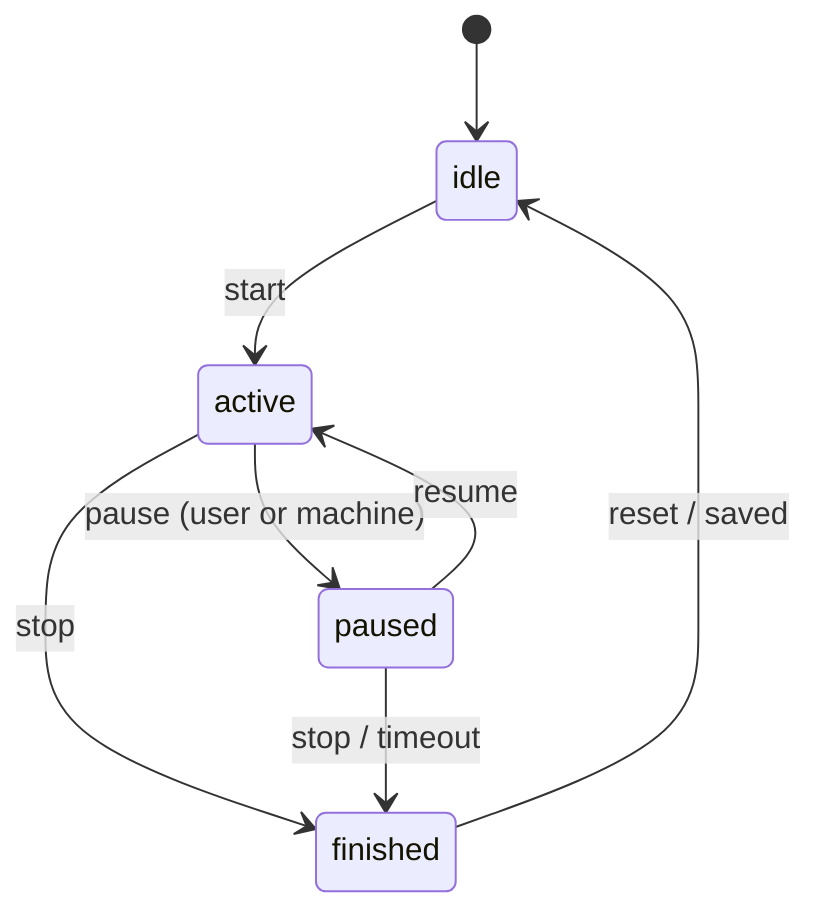

# Phase 04 — Workout Engine

**Hardware:** none for development · **Size:** M · **Blocked by:** Phases 01, 03
**Hard dependency:** V1 counter semantics from `../phase-00-probe-app/PHASE-00-FINDINGS.md`

> See `../README.md` for the collaboration model. **This entire phase is logic**: a
> state machine, some event handlers, one small hook. All of it follows the "you
> write it, the agent teaches" track. There is no new screen in this phase. It
> surfaces onto the dashboard Phase 03 already built, through a hook, and hooks are
> explicitly on the "you write it" side of the division of labour in `../README.md`.

---

## Goal

Workout lifecycle, **independent of connection lifecycle**.

### Understanding what you're building (read this before the tasks)

**The everyday problem.** `WorkoutEngine` tracks two separate things at once: what
stage the workout is at (warming up, mid-set, resting, done) and whether the app
can currently see the treadmill over Bluetooth. Those are genuinely different
facts. Losing the Bluetooth link for a few seconds doesn't cancel the workout, it
just means the app can't currently confirm what's happening, so it waits a beat
before assuming the session is over. And when a counter value comes in, the engine
needs to know whether it's "this session" or "since the treadmill powered on":
get that wrong and every number logged afterward is wrong, confidently and
silently.

Its own state (`idle`/`active`/`paused`/`finished`) is deliberately a separate
concept from `TreadmillService`'s connection state (Phase 02:
`connecting`/`discovering`/`ready`/`disconnected`). The engine subscribes to
connection events but tracks its own state independently, bridging the two only
through the `'connectionLost'` pause reason. The 60-second grace timer in task 4.2
is the "wait a beat before assuming it's over" instinct, coded as a cancellable
`setTimeout`. The counter-semantics block (task 4.3) is the "don't log a number whose
units you don't know" problem, blocked by design on `PHASE-00-FINDINGS.md` V1.

**Why not simpler.** Three places here where a flatter design looks tempting, and
each one is worth naming why it loses.

First: why not one combined type instead of two state machines, say a single
`WorkoutState` with a `'disconnected'` value bolted on? Because connection state and
workout state don't actually vary together: you can be `idle`+`ready` (connected,
not started), `active`+`disconnected` (mid-workout, radio dropped), even
`finished`+`ready` (done, still connected). Cramming four connection values against
four workout values into one union means naming and reasoning about a combinatorial
grid, most of whose cells never happen. Two small, orthogonal machines with one
explicit bridge (the pause reason) is less total surface than one bloated one.

Second: why not skip the grace timer and end the workout the instant the connection
drops? Because BLE drops transiently and often (walking past a microwave, the phone
rotating in a pocket) for a second or two, not because the session is actually over.
Ending the workout on every blip would make the app unreliable at the one thing it
exists to do: keep a workout running while you walk on a treadmill. 60 seconds and
one timer handle is cheap for that much real-world tolerance.

Third, and different in kind from the other two: the counter-semantics decision
isn't a complexity tradeoff at all. There's no "simpler" version that's also
correct. Guessing (say, defaulting to per-session because that's more common)
doesn't fail loudly the way a malformed BLE packet does; it produces a plausible,
wrong number that gets written to SQLite and stays wrong forever, because nothing
about a wrong-but-plausible distance value looks broken. That's why task 4.3 says
stop, not "guess and revisit." There's no cheap version of "guess correctly" to
fall back to.

**The pattern, named plainly.** Keeping the workout and connection state machines
separate is an application of **separation of concerns** to state design
specifically: each machine only has to be provably correct against its own small
diagram (the tests in this phase check illegal workout transitions in isolation,
never a connection concern), rather than one sprawling machine where a bug in
connection-handling can corrupt workout logic that has nothing to do with it. The
cost is real: two mental models running concurrently, and one bridging value (the
pause reason) that has to be kept honest by hand. It's worth it here because the two
concerns fail independently in the real world (a workout can be perfectly fine while
Bluetooth misbehaves, and the reverse isn't even meaningful). It would **not** be
worth it for a feature with only one plausible failure mode. If this app only ever ran
against a wired, unloseable connection, bolting a `'disconnected'` value onto the
workout state directly would be the more honest, simpler design, and splitting it in
two would be exactly the kind of complexity Metz would push back on.

## Learning goals

- Building a second state machine that runs concurrently with Phase 02's connection
  state machine, and *why* they're kept separate rather than merged into one diagram.
  A connection drop mid-workout can't be expressed cleanly as a single state.
- Subscribing to an interface's events from a plain `core/` class that isn't a hook.
  `WorkoutEngine` subscribes to `onSample`, `onMachineEvent`, and
  `onConnectionStateChange` the same way the dashboard hook does. The engine is just
  another consumer of the seam, and like the hook it has to keep its unsubscribe
  functions and call them in `dispose()`.
- **A cancel-and-restart timer**: `clearTimeout(this.graceTimer)` then a fresh
  `setTimeout`. The timer handle *is* the cancellation token. Phase 05's tap debounce
  reuses the identical shape, so understanding it here pays off twice.
- **Exhaustive `switch` over a discriminated union**: handling every `MachineEvent`
  kind, with the compiler telling you if a new kind is ever added and not handled.
- Designing methods that reject illegal calls by returning `false` instead of
  throwing, the same philosophy `TreadmillService`'s `ControlResult` already uses for
  control-point failures.

## Reference docs

- `src/core/treadmill/treadmillService.ts`: the events and types this phase consumes
  (`onSample`, `onMachineEvent`, `onConnectionStateChange`, `MachineEvent`,
  `TreadmillSample`)
- `../phase-01-protocol-decode/README.md`'s FTMS protocol reference, "Fitness
  Machine Status" section: `0x2ADA` op codes, which `MachineEvent` decodes them into
- `../phase-06-recording-schema/README.md`: the `WorkoutSample` table, specifically
  the `Flags` bit-0 gap marker this phase's output feeds (Phase 06 does the actual
  SQLite write) and the `DurationSeconds` "active time excludes pauses" rule
- `../phase-00-probe-app/PHASE-00-FINDINGS.md` V1: counter semantics. **Read this
  before writing any code in task 4.3.**
- **Narrowing and discriminated unions**: https://www.typescriptlang.org/docs/handbook/2/narrowing.html.
  The "Exhaustiveness checking" section is task 4.4's `never` trick.
- **Jest fake timers**: https://jestjs.io/docs/timer-mocks. The grace-timer tests
  advance a fake clock instead of waiting a real minute.

---

## Workout state machine



Runs concurrently with the Phase 02 connection state machine. They are separate on
purpose: one diagram cannot express "connection lost mid-workout", which is the
failure most likely to actually happen.

### Task 4.1 — Workout types and the `WorkoutEngine` skeleton

Creates: `src/core/workout/workoutTypes.ts`, `src/core/workout/workoutEngine.ts`.

Concrete steps:

1. Create the folder `src/core/workout/`. Same "does this import React Native?" test
   from Phase 01b decides this: the engine only touches `TreadmillService` types,
   none of which are platform-flavoured, so it belongs in `core/` and gets real Jest
   tests.
2. In `workoutTypes.ts`, define the four-value union from the diagram above, the
   pause reasons, and the record the engine produces (below). You need to know *why*
   you're paused to decide later whether a machine-initiated resume applies or a
   grace-timer expiry does.
3. In `workoutEngine.ts`, write the class shape below. The constructor takes the
   `TreadmillService` and subscribes to its three events immediately, keeping the
   three unsubscribe functions for `dispose()`.
4. Implement `tryStart` / `tryPause` / `tryResume` / `tryStop` for the **legal**
   transitions only, straight from the diagram. Each checks the current state first
   and returns `false` without changing anything if the call is illegal. This is
   exactly what the "illegal transitions are rejected, not crashes" test in the Tests
   section below is checking.
5. Leave `onConnectionStateChange`, `onMachineEvent`, and `onSample` as stubs for now;
   tasks 4.2, 4.3, and 4.4 fill them in one at a time.

The shape, not the implementation:

```ts
// workoutTypes.ts
export type WorkoutState = 'idle' | 'active' | 'paused' | 'finished';

export type WorkoutPauseReason = 'userRequested' | 'machineRequested' | 'connectionLost';

/**
 * One row of workout telemetry, produced while active. Phase 06 buffers and
 * flushes these into WorkoutSample.
 */
export interface WorkoutSampleRecord {
  readonly elapsedActiveSeconds: number;
  readonly speedKph: number | null;
  readonly distanceMeters: number | null;
  readonly calories: number | null;
  readonly heartRate: number | null;
  readonly isConnectionGap: boolean;
}
```

```ts
// workoutEngine.ts
export interface WorkoutEngineOptions {
  /** How long a lost connection may stay lost before the workout finishes. */
  readonly graceMs?: number; // default 60_000; tests pass something tiny
}

export class WorkoutEngine {
  private state: WorkoutState = 'idle';
  private pauseReason: WorkoutPauseReason | null = null;
  private graceTimer: ReturnType<typeof setTimeout> | null = null;
  private readonly graceMs: number;

  private readonly stateChanges = createEmitter<WorkoutState>();
  private readonly recorded = createEmitter<WorkoutSampleRecord>();
  private readonly unsubscribers: Unsubscribe[];

  constructor(private readonly treadmill: TreadmillService, options: WorkoutEngineOptions = {}) {
    this.graceMs = options.graceMs ?? 60_000;
    this.unsubscribers = [
      treadmill.onConnectionStateChange((c) => this.onConnectionStateChange(c)),
      treadmill.onMachineEvent((e) => this.onMachineEvent(e)),
      treadmill.onSample((s) => this.onSample(s)),
    ];
  }

  getState(): WorkoutState { return this.state; }
  onStateChange(listener: (state: WorkoutState) => void): Unsubscribe { return this.stateChanges.subscribe(listener); }
  onSampleRecorded(listener: (r: WorkoutSampleRecord) => void): Unsubscribe { return this.recorded.subscribe(listener); }

  tryStart(): boolean {
    // TODO: legal only from 'idle'. Set the workout-start baseline (task 4.3),
    // transition to 'active', emit the state change.
    return false;
  }

  tryPause(reason: WorkoutPauseReason): boolean {
    // TODO: legal only from 'active'.
    return false;
  }

  tryResume(): boolean {
    // TODO: legal only from 'paused'.
    return false;
  }

  tryStop(): boolean {
    // TODO: legal from 'active' or 'paused'. Cancel any running grace timer (4.2).
    return false;
  }

  dispose(): void {
    // TODO: clear the grace timer, call every unsubscriber
  }

  private onConnectionStateChange(change: ConnectionStateChange): void {
    // TODO: task 4.2
  }

  private onMachineEvent(event: MachineEvent): void {
    // TODO: task 4.4
  }

  private onSample(sample: TreadmillSample): void {
    // TODO: tasks 4.3 and 4.5
  }
}
```

6. `npx tsc --noEmit` to confirm it compiles so far.

---

## Connection-loss policy

On connection loss during `active`: transition to `paused` and start a **60-second
grace timer**. Restored within the window → resume. Not restored → `finished`, saving
whatever was recorded.

**The gap must be represented explicitly in the sample series**: write a gap marker
(`WorkoutSample.Flags` bit 0), do not interpolate across it. Charts must show a break
rather than a fabricated straight line.

### Task 4.2 — Grace timer

Fill in `onConnectionStateChange`.

Concrete steps:

1. On `change.state === 'disconnected'` while the workout is `'active'`: call
   `tryPause('connectionLost')`, then start the grace timer.
2. The timer is cancel-and-restart: clear any existing handle first, then
   `this.graceTimer = setTimeout(() => { ... }, this.graceMs)`. That's the same shape
   Phase 05's tap debounce reuses, so it's worth getting comfortable with it here
   first.
3. On `change.state === 'ready'` while paused for `'connectionLost'`: clear the grace
   timer, then `tryResume()`.
4. If the timer fires (the window passed with no reconnect), call `tryStop()`. That's
   "expiry → `finished`, saving whatever was recorded" from the policy above.
5. Set `this.graceTimer = null` whenever it's cleared or fires, so "is a grace period
   running?" is always just `this.graceTimer !== null`.
6. While paused for a lost connection, don't try to emit a record for every missed
   second. Phase 06 writing a single row with `isConnectionGap = true` at the elapsed
   second where the drop happened is enough to make the chart show a break. Don't
   backfill.

Worth knowing now, mattering in Phase 07: this timer is a JavaScript `setTimeout`, so
with the screen off it only fires if the keep-alive from Phase 00's task 0.12 is
running. Phase 07 starts the keep-alive at workout start for exactly this reason.

---

## Counter semantics — read V1 before writing any code here

| V1 verdict | What the engine does |
|------------|----------------------|
| **Per-session** | Record reported values directly |
| **Cumulative** | Every workout value is a delta against the value captured at workout start. The engine must detect a mid-workout counter reset (value decreases) and re-baseline |
| **Mixed** | Per-field handling, exactly as recorded in V1 |

**Do not guess.** Guessing wrong makes every stored workout wrong, silently, forever.

Also note: `DurationSeconds` in the schema is **active** time, excluding pauses. If the
treadmill's elapsed-time counter includes paused time, the app tracks active time
itself.

### Task 4.3 — Baseline and re-baselining

Fill in the counter-handling part of `onSample`.

Concrete steps:

1. Open `../phase-00-probe-app/PHASE-00-FINDINGS.md` and read the V1 verdict. If it's
   still blank, **stop here**. This phase has a hard dependency on it: never invent
   a value for an unmeasured field.
2. If **per-session**: the record's `distanceMeters` / `calories` are just
   `sample.distanceMeters` / `sample.calories`, passed through unchanged.
3. If **cumulative**: in `tryStart`, capture the current sample's raw distance and
   calories into private baseline fields (e.g. `distanceBaselineMeters`). Every
   subsequent sample's recorded value becomes
   `sample.distanceMeters - distanceBaselineMeters`. Remember both sides can be
   `null`; decide what a null raw value records (it should be `null`, not `0`).
4. Re-baseline detection: if a new sample's **raw** distance is *less than* the
   previous raw distance, the counter reset mid-session. Add the previous raw maximum
   into a running offset before subtracting the new baseline, so the recorded value
   stays monotonically increasing across the reset. It must never jump backward in
   a stored workout.
5. `elapsedActiveSeconds` is **not** `sample.elapsedSeconds`. Track active seconds
   yourself (increment once per accepted sample while `'active'`), per the
   `DurationSeconds` note above: the treadmill's own elapsed-time counter may include
   paused time, which this schema explicitly excludes.

---

## Machine-initiated transitions

Drive from `0x2ADA` events where Phase 00 proved the device emits them:

| Event kind | Engine response |
|-------|-----------------|
| `stoppedByUser` / `pausedByUser` | Finish or pause accordingly |
| `startedByUser` | Resume from `paused` |
| `stoppedBySafetyKey` | **Hard stop. Never attempt to restart over BLE.** |
| `controlPermissionLost` | Disable controls, re-request control (Phase 05) |

If Phase 00 found the device emits nothing on `0x2ADA`, infer state from `0x2ACD`
speed values instead. Workable but less precise. Record that in
`../phase-00-probe-app/PHASE-00-FINDINGS.md`'s "Still unresolved after this run" table.

**Do not drive workout state from `0x2AD3` Training Status.** Many budget machines
report a single value permanently.

### Task 4.4 — Wire `onMachineEvent`

Fill in `onMachineEvent`.

Concrete steps:

1. `switch (event.kind)` against the table above, with one `case` per kind.
2. Make it exhaustive: end the switch with
   ```ts
   default: {
     const unhandled: never = event;
     return unhandled;
   }
   ```
   Every `case` above narrows `event`; if all kinds are handled, nothing is left and
   `event` has type `never` here. Add a new kind to `MachineEvent` one day and forget
   to handle it, and this line stops compiling. That's the payoff of a discriminated
   union over a bag of strings.
3. `stoppedBySafetyKey` is the one case in this whole phase that isn't a normal state
   transition: call `tryStop()` and nothing else. Do not attempt any kind of
   auto-restart in response. See `TreadmillService.start`'s doc comment for why
   ("never call this without a deliberate on-screen user action").
4. `controlPermissionLost` doesn't change the workout state at all. It's Phase 05's
   concern (disable speed controls, re-request control). Put a
   `// handled in Phase 05` comment in that exact `case` so it reads as a deliberate
   boundary, not a gap. Same for `targetSpeedChanged`, `reset` and `unknown`: decide
   each one, even if the decision is "nothing."
5. If Phase 00's findings show this device emits **nothing** on `0x2ADA` during a
   session, add a row to `../phase-00-probe-app/PHASE-00-FINDINGS.md`'s "Still
   unresolved after this run" table (with this phase's number, the effort to resolve,
   and the fallback: infer `active`/`paused` from whether `sample.speedKph` is zero
   for several consecutive samples) rather than silently doing nothing.

### Task 4.5 — Gap markers in the sample series

Fold this into `onSample` alongside task 4.3:

1. While `'active'` and not currently paused for a connection loss, emit a
   `WorkoutSampleRecord` with `isConnectionGap: false` for every accepted sample.
2. The **one** exception is the sample immediately after a `connectionLost` pause
   resolves (either by resuming or by `tryStop()` at grace-timer expiry): emit
   exactly one record with `isConnectionGap: true` for the elapsed second the drop was
   first detected, so Phase 06's persistence layer has something concrete to set
   `WorkoutSample.Flags` bit 0 on.
3. This is the whole of what this phase owes Phase 06: a stream of
   `WorkoutSampleRecord`s. Phase 06 owns buffering and the actual SQLite write
   (`../phase-06-recording-schema/README.md`'s "buffer, flush every 30–60 s"
   strategy). Don't build that here.

---

## Task 4.6 — Surface workout state on the dashboard

This is the one place this phase touches something Phase 03 built, and it's still
logic, not UI. See the note at the top of this file.

Concrete steps:

1. Create the engine once in `src/features/services.tsx`
   (`workout: new WorkoutEngine(treadmill)`), same reasoning as the treadmill itself:
   one workout in progress at a time, for the whole app. It lives at module scope, so
   it keeps running whichever screen is showing.
2. Write `src/features/workout/useWorkoutState.ts`, the same two-line
   `useSyncExternalStore` shape as Phase 02's `useConnectionState`, over
   `workout.onStateChange` / `workout.getState`.
3. The UI is a single line,
   `<Text variant="caption">{workoutState}</Text>`, added to the dashboard under the
   connection row, with `const workoutState = useWorkoutState();` at the top of
   `DashboardScreen`. That's small enough not to warrant its own task; flag it at the
   review checkpoint if you'd like the agent to place it precisely rather than doing
   it yourself.

---

## Tests

Creates: `src/core/workout/workoutEngine.test.ts`. Use `jest.useFakeTimers()` and
the real `FakeTreadmillService` from Phase 01b as the engine's input.

Concrete steps:

1. A `test.each` table covering every edge in the state diagram, **including the
   illegal ones**: e.g. `tryPause('userRequested')` from `idle` must return `false`
   and leave the state `idle`, not throw.
2. Start a workout, make the fake disconnect, expect `'paused'`; reconnect within the
   window, expect `'active'` again. This is the first test that needs the fake to drop
   its connection on demand, which Phase 01b deliberately deferred: add
   `triggerDisconnect(durationMs)` from `TreadmillSimulation` to
   `FakeTreadmillService` now (emit `disconnected`, stop samples, and after
   `durationMs` emit `ready` and resume).
3. Same shape, but let the grace timer expire. Construct the engine with
   `{ graceMs: 1000 }` and `await jest.advanceTimersByTimeAsync(1001)` rather than
   waiting a real minute, and expect `'finished'`.
4. A gap-marker test: disconnect, reconnect, collect every record from
   `onSampleRecorded`, expect exactly one with `isConnectionGap: true`.
5. If V1 was cumulative: feed a sample sequence with a decreasing raw counter partway
   through, expect the recorded (baselined) distance to be monotonically increasing
   across it.
6. `dispose()` really unsubscribes: after it, emitting samples from the fake produces
   no records.
7. `npm test`, everything including regression.
8. `[HUMAN]` Press pause on the treadmill itself; the app reflects it via `0x2ADA`
   (or via the `0x2ACD` speed-inference fallback, if that's what Phase 00 found).

## Acceptance

- [ ] No illegal state reachable
- [ ] Connection loss never loses more than the grace window
- [ ] Gaps appear as breaks, never as interpolated lines
- [ ] The `switch` over `MachineEvent` is exhaustive (the `never` check compiles)
