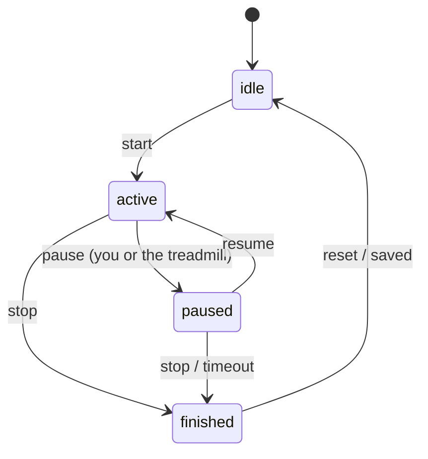

# Phase 04 — Workout Engine

**Treadmill needed:** no for building · **Size:** M · **Waits for:** Phases 01, 03
**Also needs:** Finding V1 (do counters reset?) from `PHASE-00-FINDINGS.md`

> **This whole phase is logic**, so you write all of it: a state machine, some event
> handlers, and one small hook. No new screen; it shows up on Phase 03's dashboard.

---

## Goal

Track the workout (started, paused, finished) **separately from the connection**.

### The idea

`WorkoutEngine` keeps track of two different things:

- **Where the workout is**: `idle`, `active`, `paused` or `finished`.
- **Whether the phone can see the treadmill** (the connection, from Phase 02).

They're different facts. Losing Bluetooth for a few seconds doesn't end your workout;
the app just can't see what's happening for a moment. So it waits before deciding the
workout is over.

**Why two state machines instead of one?** Because they change independently. You can
be `idle` and connected, `active` and disconnected, or `finished` and still connected.
One combined list would need a value for every combination, most of which never
happen. Two small ones, linked only by the pause reason `'connectionLost'`, are
simpler.

**Why wait 60 seconds before ending a workout?** Bluetooth drops for a second or two
all the time (a microwave, the phone moving in a pocket). Ending the workout every time
would make the app useless. A 60-second timer you can cancel costs very little.

**Why stop and check V1 instead of guessing?** Because a wrong guess doesn't crash. It
quietly saves a wrong distance, which looks normal and stays wrong forever. There's no
safe guess.

**The name for this:** *separation of concerns*. Each state machine is small enough to
be clearly correct on its own.

## What you'll learn

- Running a second state machine next to Phase 02's, and why they're kept apart.
- Listening to `TreadmillService` events from a plain class (not a hook). Like a hook,
  it must keep its unsubscribe functions and call them in `dispose()`.
- **A cancel-and-restart timer**: `clearTimeout(this.graceTimer)`, then a new
  `setTimeout`. The timer handle is how you cancel it. Phase 05 uses the same trick.
- **An exhaustive `switch`**: handle every `MachineEvent` kind, and have the compiler
  complain if a new kind is ever added and missed.
- Methods that return `false` for a call that's not allowed, instead of throwing.

## Read first

- `src/core/treadmill/treadmillService.ts`: `onSample`, `onMachineEvent`,
  `onConnectionStateChange`, `MachineEvent`, `TreadmillSample`
- Phase 01's FTMS reference, "Fitness Machine Status": what each `0x2ADA` code means
- Phase 06's `WorkoutSample` table: the gap marker (`Flags` bit 0), and "duration
  doesn't count pauses"
- `PHASE-00-FINDINGS.md` **V1. Read it before writing any code in task 4.3.**
- **Narrowing and discriminated unions**: https://www.typescriptlang.org/docs/handbook/2/narrowing.html
  (the "Exhaustiveness checking" section is task 4.4's trick)
- **Jest fake timers**: https://jestjs.io/docs/timer-mocks

---

## Workout states



This runs at the same time as Phase 02's connection states, on purpose.

### Task 4.1 — Types and the engine outline

Creates: `src/core/workout/workoutTypes.ts`, `src/core/workout/workoutEngine.ts`.

1. Create `src/core/workout/`. The engine only uses `TreadmillService` types, so it
   belongs in `core/` and gets real tests.
2. In `workoutTypes.ts`, write the types below.
3. In `workoutEngine.ts`, write the class outline below. It starts listening to the
   treadmill in the constructor and keeps the three unsubscribe functions.
4. Write `tryStart`, `tryPause`, `tryResume`, `tryStop`, allowing only the arrows in the
   diagram. Each checks the current state first and returns `false` (changing nothing)
   if the call isn't allowed.
5. Leave the three event handlers empty for now; tasks 4.2–4.4 fill them in.

```ts
// workoutTypes.ts
export type WorkoutState = 'idle' | 'active' | 'paused' | 'finished';

export type WorkoutPauseReason = 'userRequested' | 'machineRequested' | 'connectionLost';

/** One telemetry row, produced while active. Phase 06 saves these. */
export interface WorkoutSampleRecord {
  readonly elapsedActiveSeconds: number;
  readonly speedKph: number | null;
  readonly distanceMeters: number | null;
  readonly calories: number | null;
  readonly heartRate: number | null;
  readonly isConnectionGap: boolean;
}
```

```ts
// workoutEngine.ts
export interface WorkoutEngineOptions {
  /** How long a lost connection may stay lost before the workout ends. */
  readonly graceMs?: number; // default 60_000; tests use something tiny
}

export class WorkoutEngine {
  private state: WorkoutState = 'idle';
  private pauseReason: WorkoutPauseReason | null = null;
  private graceTimer: ReturnType<typeof setTimeout> | null = null;
  private readonly graceMs: number;

  private readonly stateChanges = createEmitter<WorkoutState>();
  private readonly recorded = createEmitter<WorkoutSampleRecord>();
  private readonly unsubscribers: Unsubscribe[];

  constructor(private readonly treadmill: TreadmillService, options: WorkoutEngineOptions = {}) {
    this.graceMs = options.graceMs ?? 60_000;
    this.unsubscribers = [
      treadmill.onConnectionStateChange((c) => this.onConnectionStateChange(c)),
      treadmill.onMachineEvent((e) => this.onMachineEvent(e)),
      treadmill.onSample((s) => this.onSample(s)),
    ];
  }

  getState(): WorkoutState { return this.state; }
  onStateChange(listener: (state: WorkoutState) => void): Unsubscribe { return this.stateChanges.subscribe(listener); }
  onSampleRecorded(listener: (r: WorkoutSampleRecord) => void): Unsubscribe { return this.recorded.subscribe(listener); }

  tryStart(): boolean {
    // TODO: only from 'idle'. Save the starting counter values (task 4.3), go to 'active'.
    return false;
  }

  tryPause(reason: WorkoutPauseReason): boolean {
    // TODO: only from 'active'
    return false;
  }

  tryResume(): boolean {
    // TODO: only from 'paused'
    return false;
  }

  tryStop(): boolean {
    // TODO: from 'active' or 'paused'. Cancel the grace timer (task 4.2).
    return false;
  }

  dispose(): void {
    // TODO: clear the grace timer, call every unsubscriber
  }

  private onConnectionStateChange(change: ConnectionStateChange): void {
    // TODO: task 4.2
  }

  private onMachineEvent(event: MachineEvent): void {
    // TODO: task 4.4
  }

  private onSample(sample: TreadmillSample): void {
    // TODO: tasks 4.3 and 4.5
  }
}
```

6. `npx tsc --noEmit`.

---

## When the connection drops

During `active`: go to `paused` and start a **60-second timer**. Back in time → resume.
Not back → `finished`, keeping what was recorded.

**Show the gap in the data**: write a gap marker (`Flags` bit 0). Never fill it in. A
chart must show a break, not a made-up straight line.

### Task 4.2 — The grace timer

Fill in `onConnectionStateChange`.

1. `disconnected` while `active`: `tryPause('connectionLost')`, then start the timer.
2. Cancel and restart: clear any old timer first, then
   `this.graceTimer = setTimeout(() => { ... }, this.graceMs)`.
3. `ready` while paused for `'connectionLost'`: clear the timer, then `tryResume()`.
4. If the timer fires (no reconnect in time): `tryStop()`.
5. Set `this.graceTimer = null` whenever it's cleared or fires, so "is the timer
   running?" is just `this.graceTimer !== null`.
6. While paused for a lost connection, don't record anything for the missing seconds.
   One gap marker is enough (task 4.5).

Coming up in Phase 07: this is a `setTimeout`, so with the screen off it only fires if
the keep-alive is running. Phase 07 starts the keep-alive at the start of every
workout.

---

## Counters: read V1 before writing anything here

| V1 says | The engine does |
|------------|----------------------|
| **Per session** | Record the values as they come |
| **Cumulative** | Subtract the value from the start of the workout. If a value suddenly goes down, the counter reset mid-workout: handle it (step 4) |
| **Mixed** | Each field as V1 says |

**Don't guess.** A wrong guess makes every saved workout wrong, forever.

Also: the saved duration is **active time only**, without pauses. If the treadmill's
own timer counts paused time, count active time yourself.

### Task 4.3 — Starting values and resets

Fill in the counter part of `onSample`.

1. Read V1. **If it's still blank, stop here.** Never invent a value.
2. **Per session:** the record's distance and calories are the sample's, unchanged.
3. **Cumulative:** in `tryStart`, save the current distance and calories as starting
   values. Each recorded value is `sample.distanceMeters - startDistance`. If the raw
   value is `null`, record `null`, not `0`.
4. **A reset mid-workout:** if the raw distance goes *down*, the counter reset. Add the
   last highest value to a running offset, so the recorded distance never goes
   backwards.
5. `elapsedActiveSeconds` is **not** `sample.elapsedSeconds`. Count it yourself: add one
   per sample while `active`.

---

## Things the treadmill tells you

React to `0x2ADA` events (if Phase 00 found the treadmill sends them):

| Event | The engine does |
|-------|-----------------|
| `stoppedByUser` / `pausedByUser` | Finish or pause |
| `startedByUser` | Resume from `paused` |
| `stoppedBySafetyKey` | **Hard stop. Never try to restart over Bluetooth.** |
| `controlPermissionLost` | Nothing here: Phase 05 handles it |

If the treadmill sends nothing on `0x2ADA`, work out the state from the speed instead,
and note that in the findings' "Still unresolved" table.

**Never drive the workout from `0x2AD3` (Training Status).** Many cheap machines always
send the same value.

### Task 4.4 — Machine events

Fill in `onMachineEvent`.

1. `switch (event.kind)`, one `case` per kind.
2. End with this, so the compiler checks you covered every kind:
   ```ts
   default: {
     const unhandled: never = event;
     return unhandled;
   }
   ```
   Each `case` narrows `event`. If all kinds are handled, nothing is left, so `event`
   is `never` here. Add a new kind one day and forget it, and this stops compiling.
3. `stoppedBySafetyKey`: call `tryStop()` and nothing else. Never restart.
4. `controlPermissionLost`: write `// handled in Phase 05` in that case, so it's clearly
   on purpose. Decide `targetSpeedChanged`, `reset` and `unknown` too, even if the
   answer is "nothing".
5. If the treadmill never sends `0x2ADA` events, add a row to the findings' "Still
   unresolved" table: phase 04, and the fallback (treat several zero-speed samples in a
   row as paused).

### Task 4.5 — Gap markers

Add to `onSample`, next to task 4.3:

1. While `active` (and not paused for a lost connection), send a record with
   `isConnectionGap: false` for every sample.
2. The **one** exception: right after a `connectionLost` pause ends (by resuming, or by
   the timer stopping the workout), send exactly one record with
   `isConnectionGap: true`, for the second the connection was lost. Phase 06 turns that
   into the gap marker.
3. That's all this phase owes Phase 06: a stream of records. Saving them is Phase 06's
   job.

---

## Task 4.6 — Show the workout state on the dashboard

1. Create the engine once in the services file:
   `workout: new WorkoutEngine(treadmill)`. One workout at a time, for the whole app.
   It keeps running whichever screen is open.
2. Write `src/features/workout/useWorkoutState.ts`: the same two-line
   `useSyncExternalStore` shape as Phase 02's `useConnectionState`, using
   `workout.onStateChange` and `workout.getState`.
3. On the dashboard, add `const workoutState = useWorkoutState();` and
   `<Text variant="caption">{workoutState}</Text>` under the connection row. Ask the
   agent to place it if you'd rather not.

---

## Tests

Create `src/core/workout/workoutEngine.test.ts`. Use `jest.useFakeTimers()` and the
real `FakeTreadmillService` from Phase 01b.

1. A `test.each` table covering every arrow in the diagram, **and the ones that aren't
   allowed**: e.g. `tryPause('userRequested')` from `idle` returns `false` and the state
   stays `idle`.
2. Start a workout, make the fake disconnect, expect `paused`; reconnect in time, expect
   `active`. This is the first test that needs the fake to drop its connection, which
   Phase 01b skipped: add `triggerDisconnect(durationMs)` to the fake now (send
   `disconnected`, stop samples, then after `durationMs` send `ready` and resume).
3. Same again, but let the timer run out. Create the engine with `{ graceMs: 1000 }`,
   `await jest.advanceTimersByTimeAsync(1001)`, expect `finished`.
4. Gap marker: disconnect, reconnect, collect all records, expect exactly one with
   `isConnectionGap: true`.
5. If V1 is cumulative: feed samples whose raw distance drops partway, expect the
   recorded distance to keep going up.
6. After `dispose()`, samples from the fake produce no records.
7. `npm test`.
8. Treadmill: press pause on the treadmill itself; the app shows it.

## Done when

- [ ] No state can be reached that the diagram doesn't allow
- [ ] A lost connection never loses more than the 60-second window
- [ ] Gaps show as breaks, never as filled-in lines
- [ ] The `switch` over `MachineEvent` is exhaustive (the `never` line compiles)
